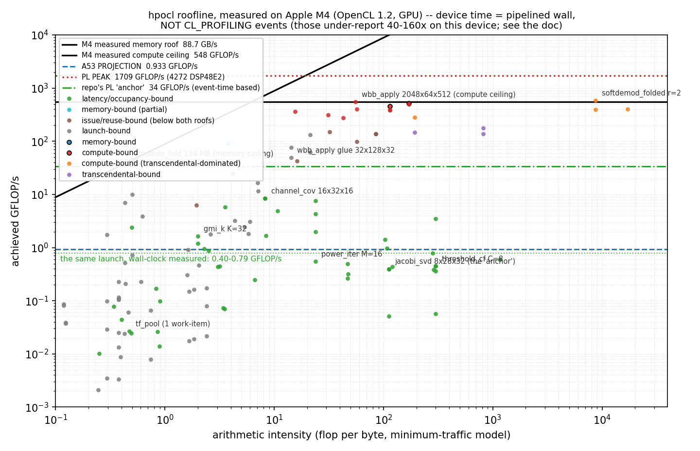

# HPOCL roofline, measured — where every operator actually sits

**Scope.** One scheduling instant of the hybrid-precoding stack (29 kernels, 10 `.cl`
sources, `make build`), priced on the only device this repo can run today: a fanless
Apple M4 (Apple OpenCL 1.2, `CL_DEVICE_TYPE_GPU`). Nothing here required a board, a
network connection, or a modification to any repo file.

**Read this before quoting any number.**

1. **The M4 is fanless and throttles 3–3.7× under load** (recorded in
   `docs/cost_model_real_shapes.md`, "Method & environment"). Absolute milliseconds on
   this host are *context*; **ratios and counts are the defensible quantities.** Every
   absolute time below carries the run-to-run spread it was measured with, and the
   classification arguments use ratios (work-item counts, cap-sweep ratios, C-scaling
   ratios, achieved-vs-ceiling fractions), never a single absolute millisecond.
2. **NEW, and stronger than (1): on this device `CL_PROFILING_COMMAND_{START,END}` —
   the column `Runtime::last_us()` returns and every "device event time" in the
   README/docs quotes — is not device execution time.** It under-reports by 42–490×
   (§2). All `t_dev` numbers in this document are therefore **pipelined wall clock**
   (R back-to-back launches, one `clFinish`, total/R), cross-checked against one-shot
   wall clock; the Apple event column is printed *alongside* every row, labelled, so
   the discrepancy is visible rather than hidden.
3. Tag discipline used throughout: **[实测]** = measured on this machine in this
   session (device time, wall time, counts, flags); **[推算]** = arithmetic on measured
   counts with a stated formula (flop/byte models, §A); **[投影]** = arithmetic on the
   repo's own stated machine models (A53: 1.4 GHz in-order, 1 fp64 flop/cycle, ×1.5
   structural; PL: 4272 DSP48E2 × 2 × 200 MHz = 1.71 Tflop/s, ~2.4 GB/s per AXI port).
   A number is never presented without one of the three.

## 0. What was run, and what was not

| target | wall | rc | note |
|---|---|---|---|
| `make op_bench` | 1 s | 0 | also run with `HPOCL_CLOPTS=-DWBB_LOCAL_MAX=4096` (`op_pl_bench`) |
| `make op_pl_bench` | <1 s | 0 | PL tile path, bit-identical gate |
| `make rate_bench` | 2 s | 0 | |
| `make cf_bench` | 2 s | 0 | prints the repo's per-config *event* times (94/66/82/68/29 µs) |
| `make decomp_bench` | 2 s | 0 | 48 cases |
| `make datapath_bench` | 2 s | 0 | |
| `make datapath_pl_bench` | <1 s | 0 | 3 runs (`LLR_CACHE_MAX=4`, `TXC_LOCAL_MAX=4`, both) |
| `make chain_bench` | 2 s | 0 | |
| `make lmmse_bench` / `rx_bench` / `fec_bench` | 1/1/<1 s | 0 | fec is host-only |
| `make tf_bench` | 2 s | 0 | validation weights (`build/tf_weights.bin`) |
| `make sched_bench` | 2.7 s | 0 | 11 cases × 4 roles + per-site sweep; **its wall column is the cross-check used in §2** |
| `build/roofline/rf_probe2` ×4 | ~6 s each | 0 | the measurement harness (§1), default build |
| `build/roofline/rf_probe2` (PL opts) | ~6 s | 0 | `-DHPOCL_FP32 -DLLR_CACHE_MAX=4 -DWBB_LOCAL_MAX=4096` (§9) |
| `build/roofline/rf_probe2` (deployed ckpt) | ~5 s | 0 | `build/tf_real.bin`, d_model=256 heads=8 layers=4 T=9 (§4 tf block) |
| `build/roofline/peak` ×2 | ~1 s each | 0 | ceiling probes (§3) |

Total bench+probe wall ≈ 40 s, well inside the budget; **nothing was skipped**. Not run
(because they are gates, not benches, and are irrelevant to timing): `asan_check`,
`allprog_check`, `tf_export_check`. `build/tf_real.bin` (the exported deployed
checkpoint, 5.29 MB) already existed in `build/`, so the deployed transformer graph was
measured without re-exporting; its dims (d_model=256, heads=8, layers=4, T=9, P=4) come
from its own header, printed by the harness as `#TFDIMS`.

## 1. Method: three views of every launch, buffers created once

`Runtime`'s wrappers create and destroy `cl_mem` buffers on **every** call (that is the
correct behaviour for a correctness gate, and it is why the README's launch-latency passage (the `clCreateBuffer`/readback accounting, line ~910 in today's README) measures
`clCreateBuffer`+release at 13–32 µs and a readback at ~1 ms). Timing through the
wrappers would therefore measure marshalling, not kernels. The scratch harness
`build/roofline/rf_probe2.cpp` instead creates each kernel's buffers **once**, sets the
arguments once (copied verbatim from the wrapper's `clSetKernelArg` sequence in
`runtime/hpocl_runtime.cpp`, so the marshalling is the shipped one), and reports three
views per case:

| view | definition | what it contains |
|---|---|---|
| `pipe` (**t_dev**, the number used everywhere) | R back-to-back `clEnqueueNDRangeKernel`, one `clFinish`, total/R | kernel execution + the per-launch dispatch cost that cannot be pipelined away |
| `one` | median of 7 × (enqueue + `clFinish`) | the synchronous-launch view: dispatch round-trip + execution |
| `ev` | median `CL_PROFILING_COMMAND_END − START` | what `Runtime::last_us()` / the README quote |

R is chosen per case so the pipelined phase is ≥ ~4 ms (5–60 launches). Each case is
then repeated in **4 independent process runs**; the table's `t_dev` is the median of
those 4 medians and `spread` is max/min across them (median 1.36× over all rows, 1.06×
for rows above 200 µs — the first run of a session is systematically slow, which is
exactly the throttle of caveat (1)). Every row also carries the finite-fraction of its
output buffer, so a capacity guard that tripped (NaN sentinels) could not masquerade as
a fast kernel; the one row where it is 0 (`threshold_cf` near-flat) is *expected* to be
non-finite: flag 2 returns τ = +inf by contract.

Kernels are launched from **one program containing all ten `.cl` sources** — the same
whole-library build `allprog_check` performs and the `.xclbin` link does across `.xo`
files — so no row is measured on a per-bench subset of the library.

Device record [实测, `clGetDeviceInfo`]: name "Apple M4", type GPU, OpenCL 1.2,
10 compute units, reported max clock 1000 MHz, global memory 12.7 GB,
`CL_DEVICE_LOCAL_MEM_SIZE` 32 768 B, `CL_DEVICE_MAX_WORK_GROUP_SIZE` 256,
`CL_DEVICE_DOUBLE_FP_CONFIG` = 0 (no fp64 — i.e. the program is built exactly as the PL
build is, fp32). Apple reports no SIMD width and no cache size, so **no
vendor-independent fp32 peak is derivable from the device record**; the ceilings in §3
are therefore the best *achieved* rates, not a theoretical peak.

## 2. The timestamp finding: the repo's "device event time" column is not time

Three independent views of the same launches disagree by two orders of magnitude, and
only one of them is physically possible:

| launch | flops / bytes (exact counts) | `ev` (Apple) | implied by `ev` | `pipe` [实测] | implied by `pipe` |
|---|---|---|---|---|---|
| `modulo_fold_k` n=2^23 | 134.2 MB moved | 34.5 µs | **3.9 TB/s** | 1513.6 µs | **88.7 GB/s** |
| `wbb_apply` 512×512×512 | 1.0737 Gflop | 48.5 µs | **22.1 Tflop/s** | 2073.6 µs | **517.8 GFLOP/s** |
| `jacobi_svd` C=8 28×32 cap16 | 20.32 Mflop executed | 1218 µs | 16.7 GFLOP/s | 51 308 µs | **0.396 GFLOP/s** |
| `threshold_cf` C=8 K=8 d=4 M=64 | 0.336 Mflop + 28.9 k transcendentals | 16.4 µs | 20.5 GFLOP/s | 754.0 µs | **0.446 GFLOP/s** |

The `ev`-implied rates are impossible: 3.9 TB/s is ~44× this machine's DRAM rate and
22 Tflop/s is ~4–5× the M4 GPU's entire fp32 peak. The `pipe`-implied rates land exactly
where physics says they should: 88.7 GB/s against the M4's ~120 GB/s theoretical
unified-memory bandwidth, and 518 GFLOP/s for a naive GEMV-per-work-item GEMM.
`build/roofline/ts_check.cpp` makes the same point with a fourth view: 20 pipelined
launches of the 1.07 Gflop GEMM take 40.8 ms total (2.04 ms/launch), while 10 pipelined
launches of the 134 MB fold take 14.6 ms (1.46 ms/launch) — the pipelined total scales
with *work*, which a fixed launch latency cannot do. Across all 130 measured rows the
median `t_dev/ev` ratio is **63.9×** (p10 43×, p90 417×).

**Consequences, stated plainly, for numbers already in this repo:**

* `op_bench`'s "wbb_apply … 325–364 GFLOP/s" and README's tiling table
  (128→338 GFLOP/s) are event-derived and ~40× high as *rates*; the **relative**
  occupancy effect in that table (untiled 364 > tiled-1 KB 338 > tiled-32 KB 58) is a
  ratio of event times of the same kernel and survives (§9 re-measures it with wall
  clock and gets the same sign).
* `cf_bench`'s "device event time, 5 configs, 409 µs total" and `sched_bench`'s
  "kernel 1468/1179/1204/1063 µs (svd … + threshold …)" are event-derived; the true
  device times are ~40× larger (the 28×32 C=8 batch: 51.3 ms, §6).
* `sched_bench`'s "glue: 3 launches 3.15 Mflop | kernel 1 us" is the same artifact; the
  three glue launches cost ~21 + 14 + 14 µs of device time (§4).
* the README's instruction (line ~914 today) — "Quote the kernel-event column, never the wall column" —
  is **inverted on this device**. The wall column is the truth here. The strongest
  cross-check is the repo's own log: `sched_bench` prints, for every case, a wall of
  ~48–58 ms for a scheduling instant that contains exactly one 28×32 C=8 launch, and
  the same README passage attributes a 50.2 ms `clEnqueueNDRangeKernel`+`clFinish` to "driver launch
  latency". My independent pipelined measurement of that one launch is **51.3 ms** —
  the wall column was measuring the kernel all along.
* What **survives** unharmed: every host wall-clock number (front_end 4.19 ms etc. —
  host timers); every correctness gate; and every **ratio of event times between two
  runs of the same kernel at the same shape**, because the bias cancels — e.g. the
  cap-8-vs-cap-16 event ratio 0.98–1.006 and the `PSI_SCAN_N` 409/408 µs ratio 1.002.
  Both of those ratios are re-confirmed below with wall clock (§6, §9).

## 3. Measured ceilings, floor and ridge [实测]

| quantity | value | how it was measured |
|---|---|---|
| compute ceiling | **547.7 GFLOP/s** | `wbb_apply` M=2048 N=64 SC=512, 0.537 Gflop with an *exact* flop count (`8·M·N·SC`, `runtime/hpocl_schedule.cpp:46`); 517.8 GFLOP/s at 512³ |
| memory ceiling | **88.7 GB/s** | `modulo_fold_k` over 134.2 MB (16 B moved per element, ~8 flops/element): 1513.6 µs; 82.6–90.6 GB/s across sizes 34/67/134/268 MB and runs |
| ridge point | **6.18 flop/byte** | 547.7 / 88.7 |
| transcendental ceiling | **22.2 Gexp/s** | best `exp` throughput reached, in `softdemod_folded_k` radius 3 / `softdemod_llr_k` m=8 |
| dispatch floor (pipelined) | **14.85 µs** (median 29.0 µs) | `tf_add_elem` n=256, R back-to-back launches: the irreducible per-launch cost of this queue on this device |
| dispatch floor (synchronous) | **247 µs** | same kernel, one enqueue + `clFinish`: what a single blocking launch costs in host time |

For context only [投影/vendor]: Apple markets the M4 GPU at ≈4.5 Tflop/s fp32, so the
library's best kernel reaches ~12% of the silicon; the 88.7 GB/s sits at ~74% of the
~120 GB/s theoretical unified-memory bandwidth. Neither vendor number is used anywhere
else in this document — the two measured ceilings above are the roofline's roofs.

## 4. The roofline table

One row per measured (operator, shape). Columns:

* `t_dev µs [实测]` — pipelined device time, median of 4 process runs; `spread` = max/min across those runs.
* `flops [推算]`, `bytes(min) [推算]` — the analytic models of §A, evaluated at the shape. `bytes(min)` is the *minimum* global traffic the kernel's parameter shapes imply (each buffer touched once).
* `AI(min)` = flops/bytes(min); `AI(no-cache)` = flops/bytes(no-cache) for the three kernels whose work-items re-read global rows (`channel_cov` M+1×, `power_iter` iters×, `wbb_apply` untiled 2·M·SC·N×). `GB/s(no-cache)` > the memory ceiling is not an error: it means the M4's caches absorbed the re-reads, and it is exactly the traffic the **cache-less PL** would pay.
* `Apple event µs` and `t_dev/event` — the repo's quoted column and its error factor (§2).
* `class (M4, 实测)` — §5. `PL t_mem / t_cmp [投影]` — bytes(no-cache)/2.4 GB/s vs flops/1.71 Tflop/s: which roof binds **on the fabric**.

### `channel_cov`

| operator | shape | t_dev µs [实测] | spread | flops [推算] | bytes(min) | AI(min) | AI(no-cache) | GFLOP/s | GB/s(min) | GB/s(no-cache) | Apple event µs | t_dev/event | class (M4, 实测) | PL t_mem ms @2.4 GB/s [投影] | PL t_cmp ms @1.71 Tflop/s [投影] |
|---|---|---|---|---|---|---|---|---|---|---|---|---|---|---|---|---|
| `channel_cov` | M=16 N=16 S=32 | 66.3 | 2.91× | 557.06 k | 67.58 k | 8.24 | 0.499 | 8.4 | 1.02 | 16.8 | 1.28 | 52× | latency/occupancy-bound | 0.4651 | 0.0003258 |
| `channel_cov` | M=16 N=32 S=16 | 66.7 | 3.54× | 557.06 k | 67.58 k | 8.24 | 0.499 | 8.356 | 1.01 | 16.7 | 1.19 | 56× | latency/occupancy-bound | 0.4651 | 0.0003258 |
| `channel_cov` | M=32 N=64 S=32 | 205.4 | 2.46× | 8.65 M | 532.48 k | 16.2 | 0.5 | 42.12 | 2.59 | 84.3 | 4.69 | 44× | issue/reuse-bound (below both roofs) | 7.212 | 0.005059 |
| `channel_cov` | M=4 N=128 S=16 | 186.8 | 3.54× | 163.84 k | 65.66 k | 2.5 | 0.5 | 0.8772 | 0.352 | 1.76 | 4.29 | 44× | latency/occupancy-bound | 0.1366 | 9.581e-05 |
| `channel_cov` | M=64 N=64 S=64 | 454.6 | 2.09× | 68.16 M | 2.13 M | 32 | 0.5 | 149.9 | 4.68 | 300 | 9.57 | 48× | issue/reuse-bound (below both roofs) | 56.81 | 0.03986 |

### `power_iter`

| operator | shape | t_dev µs [实测] | spread | flops [推算] | bytes(min) | AI(min) | AI(no-cache) | GFLOP/s | GB/s(min) | GB/s(no-cache) | Apple event µs | t_dev/event | class (M4, 实测) | PL t_mem ms @2.4 GB/s [投影] | PL t_cmp ms @1.71 Tflop/s [投影] |
|---|---|---|---|---|---|---|---|---|---|---|---|---|---|---|---|---|
| `power_iter` | M=16 iters=24 nmat=1 | 95.3 | 1.75× | 51.84 k | 2.18 k | 23.8 | 1.05 | 0.544 | 0.0229 | 0.517 | 1.91 | 50× | latency/occupancy-bound | 0.02053 | 3.032e-05 |
| `power_iter` | M=16 iters=24 nmat=8 | 96.6 | 1.49× | 414.72 k | 17.44 k | 23.8 | 1.05 | 4.291 | 0.18 | 4.08 | 1.93 | 50× | latency/occupancy-bound | 0.1643 | 0.0002425 |
| `power_iter` | M=32 iters=24 nmat=8 | 213.1 | 1.44× | 1.62 M | 67.62 k | 23.9 | 1.03 | 7.584 | 0.317 | 7.39 | 3.75 | 57× | latency/occupancy-bound | 0.6562 | 0.000945 |
| `power_iter` | M=64 iters=24 nmat=1 | 400.2 | 1.43× | 797.18 k | 33.28 k | 24 | 1.01 | 1.992 | 0.0832 | 1.97 | 7.44 | 54× | latency/occupancy-bound | 0.3279 | 0.0004662 |

### `deflate`

| operator | shape | t_dev µs [实测] | spread | flops [推算] | bytes(min) | AI(min) | AI(no-cache) | GFLOP/s | GB/s(min) | GB/s(no-cache) | Apple event µs | t_dev/event | class (M4, 实测) | PL t_mem ms @2.4 GB/s [投影] | PL t_cmp ms @1.71 Tflop/s [投影] |
|---|---|---|---|---|---|---|---|---|---|---|---|---|---|---|---|---|
| `deflate` | M=16 (one launch = one matrix; wrapper loops nmat) | 11.2 | 1.39× | 2.56 k | 4.22 k | 0.606 | 0.606 | 0.2285 | 0.377 | 0.377 | 0.05 | 218× | launch-bound | 0.00176 | 1.497e-06 |
| `deflate` | M=64 (one launch = one matrix; wrapper loops nmat) | 10.6 | 1.24× | 40.96 k | 66.05 k | 0.62 | 0.62 | 3.859 | 6.22 | 6.22 | 0.07 | 162× | launch-bound | 0.02752 | 2.395e-05 |

### `switch_threshold`

| operator | shape | t_dev µs [实测] | spread | flops [推算] | bytes(min) | AI(min) | AI(no-cache) | GFLOP/s | GB/s(min) | GB/s(no-cache) | Apple event µs | t_dev/event | class (M4, 实测) | PL t_mem ms @2.4 GB/s [投影] | PL t_cmp ms @1.71 Tflop/s [投影] |
|---|---|---|---|---|---|---|---|---|---|---|---|---|---|---|---|---|
| `switch_threshold` | count=256 | 13.0 | 2.17× | 1.28 k | 4.35 k | 0.294 | 0.294 | 0.09881 | 0.336 | 0.336 | 0.07 | 192× | launch-bound | 0.001813 | 7.485e-07 |
| `switch_threshold` | count=4096 | 11.7 | 1.83× | 20.48 k | 69.63 k | 0.294 | 0.294 | 1.744 | 5.93 | 5.93 | 0.10 | 123× | launch-bound | 0.02901 | 1.198e-05 |
| `switch_threshold` | count=64 | 11.1 | 1.27× | 320 | 1.09 k | 0.294 | 0.294 | 0.02884 | 0.0981 | 0.0981 | 0.07 | 166× | launch-bound | 0.0004533 | 1.871e-07 |
| `switch_threshold` | count=8 | 11.4 | 1.35× | 40 | 136 | 0.294 | 0.294 | 0.003512 | 0.0119 | 0.0119 | 0.06 | 178× | launch-bound | 5.667e-05 | 2.339e-08 |

### `wbb_apply`

| operator | shape | t_dev µs [实测] | spread | flops [推算] | bytes(min) | AI(min) | AI(no-cache) | GFLOP/s | GB/s(min) | GB/s(no-cache) | Apple event µs | t_dev/event | class (M4, 实测) | PL t_mem ms @2.4 GB/s [投影] | PL t_cmp ms @1.71 Tflop/s [投影] |
|---|---|---|---|---|---|---|---|---|---|---|---|---|---|---|---|---|
| `wbb_apply` | M=1024 N=1024 SC=16 (0.134 Gflop) | 371.8 | 1.00× | 134.22 M | 8.65 M | 15.5 | 0.5 | 361 | 23.3 | 722 | 7.90 | 47× | compute-bound | 111.9 | 0.07849 |
| `wbb_apply` | M=1024 N=1024 SC=64 (0.537 Gflop) | 1322.4 | 1.00× | 536.87 M | 9.44 M | 56.9 | 0.5 | 406 | 7.14 | 812 | 29.80 | 44× | compute-bound | 447.6 | 0.314 |
| `wbb_apply` | M=1024 N=256 SC=256 (0.537 Gflop) | 1380.5 | 1.00× | 536.87 M | 4.72 M | 114 | 0.499 | 388.9 | 3.42 | 779 | 31.40 | 44× | compute-bound | 448.3 | 0.314 |
| `wbb_apply` | M=128 N=128 SC=128 | 60.7 | 1.20× | 16.78 M | 393.22 k | 42.7 | 0.498 | 276.4 | 6.48 | 555 | 1.03 | 59× | compute-bound | 14.04 | 0.009811 |
| `wbb_apply` | M=16 N=16 SC=64 op_bench shape | 11.4 | 1.25× | 131.07 k | 18.43 k | 7.11 | 0.485 | 11.5 | 1.62 | 23.7 | 0.08 | 142× | launch-bound | 0.1126 | 7.665e-05 |
| `wbb_apply` | M=2048 N=64 SC=512 (0.537 Gflop) | 980.3 | 1.00× | 536.87 M | 9.70 M | 55.4 | 0.496 | 547.7 | 9.89 | 1.1e+03 | 21.40 | 46× | compute-bound | 450.9 | 0.314 |
| `wbb_apply` | M=256 N=256 SC=1024 (0.537 Gflop) | 1386.0 | 1.00× | 536.87 M | 4.72 M | 114 | 0.499 | 387.4 | 3.4 | 776 | 30.80 | 45× | compute-bound | 448.3 | 0.314 |
| `wbb_apply` | M=32 N=128 SC=32 glue H*F_RF | 21.3 | 1.68× | 1.05 M | 73.73 k | 14.2 | 0.498 | 49.18 | 3.46 | 98.7 | 0.33 | 64× | launch-bound | 0.8772 | 0.0006132 |
| `wbb_apply` | M=32 N=32 SC=128 glue F_RF*N_k / F_RF*F_BB | 13.8 | 1.15× | 1.05 M | 73.73 k | 14.2 | 0.492 | 75.78 | 5.33 | 154 | 0.13 | 105× | launch-bound | 0.8875 | 0.0006132 |
| `wbb_apply` | M=4 N=128 SC=8 | 18.5 | 1.11× | 32.77 k | 12.54 k | 2.61 | 0.498 | 1.774 | 0.679 | 3.56 | 0.28 | 65× | launch-bound | 0.02741 | 1.916e-05 |
| `wbb_apply` | M=512 N=512 SC=512 (1.074 Gflop) | 2170.6 | 1.00× | 1.07 G | 6.29 M | 171 | 0.5 | 494.7 | 2.9 | 990 | 110.80 | 20× | compute-bound | 895.7 | 0.6279 |
| `wbb_apply` | M=64 N=64 SC=64 | 15.9 | 1.22× | 2.10 M | 98.30 k | 21.3 | 0.496 | 131.5 | 6.16 | 265 | 0.21 | 76× | launch-bound | 1.761 | 0.001226 |

### `thp_precoder`

| operator | shape | t_dev µs [实测] | spread | flops [推算] | bytes(min) | AI(min) | AI(no-cache) | GFLOP/s | GB/s(min) | GB/s(no-cache) | Apple event µs | t_dev/event | class (M4, 实测) | PL t_mem ms @2.4 GB/s [投影] | PL t_cmp ms @1.71 Tflop/s [投影] |
|---|---|---|---|---|---|---|---|---|---|---|---|---|---|---|---|---|
| `thp_precoder` | SC=256 M=32 K=8 | 36.1 | 1.36× | 593.92 k | 84.48 k | 7.03 | 7.03 | 16.45 | 2.34 | 2.34 | 0.75 | 48× | launch-bound | 0.0352 | 0.0003473 |
| `thp_precoder` | SC=32 M=32 K=8 | 40.8 | 1.31× | 74.24 k | 12.80 k | 5.8 | 5.8 | 1.818 | 0.313 | 0.313 | 0.73 | 56× | launch-bound | 0.005333 | 4.342e-05 |
| `thp_precoder` | SC=64 M=16 K=8 op_bench shape | 26.9 | 1.07× | 82.94 k | 13.82 k | 6 | 6 | 3.078 | 0.513 | 0.513 | 0.45 | 60× | launch-bound | 0.00576 | 4.851e-05 |
| `thp_precoder` | SC=64 M=32 K=16 KMAX | 68.0 | 1.72× | 329.73 k | 30.72 k | 10.7 | 10.7 | 4.853 | 0.452 | 0.452 | 1.49 | 46× | latency/occupancy-bound | 0.0128 | 0.0001928 |

### `jacobi_svd`

| operator | shape | t_dev µs [实测] | spread | flops [推算] | bytes(min) | AI(min) | AI(no-cache) | GFLOP/s | GB/s(min) | GB/s(no-cache) | Apple event µs | t_dev/event | class (M4, 实测) | PL t_mem ms @2.4 GB/s [投影] | PL t_cmp ms @1.71 Tflop/s [投影] |
|---|---|---|---|---|---|---|---|---|---|---|---|---|---|---|---|---|
| `jacobi_svd` | C=1 m=28 d=32 sweeps=16 | 50072.1 | 1.06× | 2.54 M | 22.66 k | 112 | 112 | 0.05072 | 0.000452 | 0.000452 | 1182.50 | 42× | latency/occupancy-bound | 0.00944 | 0.001485 |
| `jacobi_svd` | C=2 m=4 d=8 sweeps=16 (gp248_c/v1_a/v1_b) | 314.3 | 1.06× | 100.35 k | 2.11 k | 47.5 | 47.5 | 0.3193 | 0.00672 | 0.00672 | 6.18 | 51× | latency/occupancy-bound | 0.00088 | 5.869e-05 |
| `jacobi_svd` | C=3 m=12 d=18 sweeps=16 (v2_a) | 5063.2 | 1.02× | 2.20 M | 18.36 k | 120 | 120 | 0.4351 | 0.00363 | 0.00363 | 118.91 | 43× | latency/occupancy-bound | 0.00765 | 0.001288 |
| `jacobi_svd` | C=4 m=12 d=16 sweeps=16 (gp248_b null shape) | 3684.2 | 1.05× | 967.68 k | 20.74 k | 46.7 | 46.7 | 0.2627 | 0.00563 | 0.00563 | 84.51 | 44× | latency/occupancy-bound | 0.00864 | 0.0005659 |
| `jacobi_svd` | C=8 m=12 d=16 sweeps=16 (gp248_b/fair_b/paper_k4) | 3948.7 | 1.03× | 1.94 M | 41.47 k | 46.7 | 46.7 | 0.4901 | 0.0105 | 0.0105 | 91.44 | 43× | latency/occupancy-bound | 0.01728 | 0.001132 |
| `jacobi_svd` | C=8 m=14 d=16 sweeps=16 (fair_c/main_b) | 5019.5 | 1.03× | 4.92 M | 45.57 k | 108 | 108 | 0.9792 | 0.00908 | 0.00908 | 116.78 | 43× | latency/occupancy-bound | 0.01899 | 0.002874 |
| `jacobi_svd` | C=8 m=28 d=32 sweeps=16 (paper_sweep null batch, THE anchor) | 51308.2 | 1.03× | 20.32 M | 181.25 k | 112 | 112 | 0.396 | 0.00353 | 0.00353 | 1218.34 | 42× | latency/occupancy-bound | 0.07552 | 0.01188 |
| `jacobi_svd` | C=8 m=28 d=32 sweeps=8 | 51659.4 | 1.08× | 20.32 M | 181.25 k | 112 | 112 | 0.3933 | 0.00351 | 0.00351 | 1224.34 | 42× | latency/occupancy-bound | 0.07552 | 0.01188 |
| `jacobi_svd` | C=8 m=32 d=40 sweeps=16 (shipped capacity ceiling) | 95225.7 | 1.03× | 75.08 M | 267.52 k | 281 | 281 | 0.7884 | 0.00281 | 0.00281 | 2292.05 | 42× | latency/occupancy-bound | 0.1115 | 0.04391 |
| `jacobi_svd` | C=8 m=4 d=4 sweeps=16 (whitening batches) | 85.1 | 1.55× | 21.12 k | 3.20 k | 6.6 | 6.6 | 0.2481 | 0.0376 | 0.0376 | 1.11 | 77× | latency/occupancy-bound | 0.001333 | 1.235e-05 |
| `jacobi_svd` | C=8 m=8 d=16 sweeps=16 (v1_c) | 2455.3 | 1.05× | 3.44 M | 33.28 k | 103 | 103 | 1.401 | 0.0136 | 0.0136 | 56.58 | 43× | latency/occupancy-bound | 0.01387 | 0.002012 |

### `gmd_k`

| operator | shape | t_dev µs [实测] | spread | flops [推算] | bytes(min) | AI(min) | AI(no-cache) | GFLOP/s | GB/s(min) | GB/s(no-cache) | Apple event µs | t_dev/event | class (M4, 实测) | PL t_mem ms @2.4 GB/s [投影] | PL t_cmp ms @1.71 Tflop/s [投影] |
|---|---|---|---|---|---|---|---|---|---|---|---|---|---|---|---|---|
| `gmd_k` | C=1 rows=16 d=8 (GMD_MAXM x GMD_MAXD) | 85.7 | 1.24× | 2.22 k | 2.59 k | 0.858 | 0.858 | 0.02594 | 0.0302 | 0.0302 | 1.34 | 64× | latency/occupancy-bound | 0.00108 | 1.301e-06 |
| `gmd_k` | C=1 rows=4 d=4 (as design_instant calls it) | 37.8 | 1.59× | 296 | 400 | 0.74 | 0.74 | 0.007831 | 0.0106 | 0.0106 | 0.32 | 120× | launch-bound | 0.0001667 | 1.731e-07 |
| `gmd_k` | C=8 rows=4 d=4 (paper_sweep per-user) | 35.9 | 1.75× | 2.37 k | 3.20 k | 0.74 | 0.74 | 0.06595 | 0.0891 | 0.0891 | 0.32 | 111× | launch-bound | 0.001333 | 1.385e-06 |
| `gmd_k` | C=8 rows=8 d=8 | 61.8 | 1.74× | 10.37 k | 12.54 k | 0.827 | 0.827 | 0.1678 | 0.203 | 0.203 | 0.86 | 72× | latency/occupancy-bound | 0.005227 | 6.063e-06 |

### `ucd_k`

| operator | shape | t_dev µs [实测] | spread | flops [推算] | bytes(min) | AI(min) | AI(no-cache) | GFLOP/s | GB/s(min) | GB/s(no-cache) | Apple event µs | t_dev/event | class (M4, 实测) | PL t_mem ms @2.4 GB/s [投影] | PL t_cmp ms @1.71 Tflop/s [投影] |
|---|---|---|---|---|---|---|---|---|---|---|---|---|---|---|---|---|
| `ucd_k` | C=1 rows=16 d=8 (GMD_MAXM x GMD_MAXD) wf=0 | 125.0 | 1.20× | 9.07 k | 2.66 k | 3.41 | 3.41 | 0.07258 | 0.0213 | 0.0213 | 2.33 | 54× | latency/occupancy-bound | 0.001108 | 5.305e-06 |
| `ucd_k` | C=1 rows=16 d=8 (GMD_MAXM x GMD_MAXD) wf=1 | 132.5 | 1.06× | 9.31 k | 2.66 k | 3.5 | 3.5 | 0.07025 | 0.0201 | 0.0201 | 2.43 | 55× | latency/occupancy-bound | 0.001108 | 5.446e-06 |
| `ucd_k` | C=1 rows=4 d=4 (as design_instant calls it) wf=0 | 41.4 | 2.75× | 728 | 436 | 1.67 | 1.67 | 0.01757 | 0.0105 | 0.0105 | 0.44 | 95× | launch-bound | 0.0001817 | 4.257e-07 |
| `ucd_k` | C=1 rows=4 d=4 (as design_instant calls it) wf=1 | 41.5 | 1.07× | 800 | 436 | 1.83 | 1.83 | 0.01928 | 0.0105 | 0.0105 | 0.50 | 83× | launch-bound | 0.0001817 | 4.678e-07 |
| `ucd_k` | C=8 rows=4 d=4 (paper_sweep per-user) wf=0 | 38.7 | 1.21× | 5.82 k | 3.49 k | 1.67 | 1.67 | 0.1506 | 0.0902 | 0.0902 | 0.44 | 88× | launch-bound | 0.001453 | 3.406e-06 |
| `ucd_k` | C=8 rows=4 d=4 (paper_sweep per-user) wf=1 | 39.3 | 1.20× | 6.40 k | 3.49 k | 1.83 | 1.83 | 0.163 | 0.0888 | 0.0888 | 0.50 | 79× | launch-bound | 0.001453 | 3.743e-06 |
| `ucd_k` | C=8 rows=8 d=8 wf=0 | 90.6 | 1.15× | 39.81 k | 13.09 k | 3.04 | 3.04 | 0.4394 | 0.144 | 0.144 | 1.55 | 59× | latency/occupancy-bound | 0.005453 | 2.328e-05 |
| `ucd_k` | C=8 rows=8 d=8 wf=1 | 93.7 | 1.19× | 41.73 k | 13.09 k | 3.19 | 3.19 | 0.4453 | 0.14 | 0.14 | 1.71 | 55× | latency/occupancy-bound | 0.005453 | 2.44e-05 |

### `cbd_k`

| operator | shape | t_dev µs [实测] | spread | flops [推算] | bytes(min) | AI(min) | AI(no-cache) | GFLOP/s | GB/s(min) | GB/s(no-cache) | Apple event µs | t_dev/event | class (M4, 实测) | PL t_mem ms @2.4 GB/s [投影] | PL t_cmp ms @1.71 Tflop/s [投影] |
|---|---|---|---|---|---|---|---|---|---|---|---|---|---|---|---|---|
| `cbd_k` | C=1 urows=16 vrows=8 d=8 (CBD_MAXM x CBD_MAXD) | 232.5 | 1.42× | 3.23 k | 3.62 k | 0.893 | 0.893 | 0.0139 | 0.0156 | 0.0156 | 4.69 | 50× | latency/occupancy-bound | 0.001508 | 1.89e-06 |
| `cbd_k` | C=8 urows=4 vrows=4 d=4 | 48.4 | 1.10× | 4.74 k | 5.28 k | 0.897 | 0.897 | 0.09786 | 0.109 | 0.109 | 0.67 | 72× | latency/occupancy-bound | 0.0022 | 2.77e-06 |

### `threshold_cf`

| operator | shape | t_dev µs [实测] | spread | flops [推算] | bytes(min) | AI(min) | AI(no-cache) | GFLOP/s | GB/s(min) | GB/s(no-cache) | Apple event µs | t_dev/event | class (M4, 实测) | PL t_mem ms @2.4 GB/s [投影] | PL t_cmp ms @1.71 Tflop/s [投影] |
|---|---|---|---|---|---|---|---|---|---|---|---|---|---|---|---|---|
| `threshold_cf` | C=1 K=8 d=4 M=64 GMD (single channel) | 740.7 | 1.02× | 42.00 k | 140 | 300 | 300 | 0.05671 | 0.000189 | 0.000189 | 16.50 | 45× | latency/occupancy-bound | 5.833e-05 | 2.456e-05 |
| `threshold_cf` | C=64 K=8 d=4 M=64 GMD (8 instants batched) | 767.2 | 1.23× | 2.69 M | 8.96 k | 300 | 300 | 3.504 | 0.0117 | 0.0117 | 16.64 | 46× | latency/occupancy-bound | 0.003733 | 0.001572 |
| `threshold_cf` | C=8 K=4 d=2 M=16 GMD (cf_bench cfg1) | 263.1 | 1.38× | 100.80 k | 352 | 286 | 286 | 0.3831 | 0.00134 | 0.00134 | 5.34 | 49× | latency/occupancy-bound | 0.0001467 | 5.895e-05 |
| `threshold_cf` | C=8 K=8 d=4 M=256 GMD (cf_bench cfg4) | 744.3 | 1.03× | 336.00 k | 1.12 k | 300 | 300 | 0.4514 | 0.0015 | 0.0015 | 16.46 | 45× | latency/occupancy-bound | 0.0004667 | 0.0001965 |
| `threshold_cf` | C=8 K=8 d=4 M=64 GMD (paper_sweep, well-conditioned) | 754.0 | 1.02× | 336.00 k | 1.12 k | 300 | 300 | 0.4456 | 0.00149 | 0.00149 | 16.44 | 46× | latency/occupancy-bound | 0.0004667 | 0.0001965 |
| `threshold_cf` | C=8 K=8 d=4 M=64 GMD near-flat (flag 1/2 scan path) | 2157.0 | 1.03× | 1.30 M | 1.12 k | 1.16e+03 | 1.16e+03 | 0.6008 | 0.000519 | 0.000519 | 50.08 | 43× | latency/occupancy-bound | 0.0004667 | 0.0007579 |
| `threshold_cf` | C=8 K=8 d=4 M=64 UCD (paper_sweep) | 933.7 | 1.03× | 336.00 k | 1.12 k | 300 | 300 | 0.3599 | 0.0012 | 0.0012 | 21.01 | 44× | latency/occupancy-bound | 0.0004667 | 0.0001965 |

### `qam_map_k`

| operator | shape | t_dev µs [实测] | spread | flops [推算] | bytes(min) | AI(min) | AI(no-cache) | GFLOP/s | GB/s(min) | GB/s(no-cache) | Apple event µs | t_dev/event | class (M4, 实测) | PL t_mem ms @2.4 GB/s [投影] | PL t_cmp ms @1.71 Tflop/s [投影] |
|---|---|---|---|---|---|---|---|---|---|---|---|---|---|---|---|---|
| `qam_map_k` | m=6 nsymtot=2048 (T=32 nsym=64) | 23.7 | 1.81× | 12.29 k | 28.67 k | 0.429 | 0.429 | 0.5186 | 1.21 | 1.21 | 0.08 | 306× | launch-bound | 0.01195 | 7.186e-06 |
| `qam_map_k` | m=6 nsymtot=32768 (T=32 nsym=1024) | 28.5 | 1.54× | 196.61 k | 458.75 k | 0.429 | 0.429 | 6.907 | 16.1 | 16.1 | 0.13 | 216× | launch-bound | 0.1911 | 0.000115 |

### `tx_combine_k`

| operator | shape | t_dev µs [实测] | spread | flops [推算] | bytes(min) | AI(min) | AI(no-cache) | GFLOP/s | GB/s(min) | GB/s(no-cache) | Apple event µs | t_dev/event | class (M4, 实测) | PL t_mem ms @2.4 GB/s [投影] | PL t_cmp ms @1.71 Tflop/s [投影] |
|---|---|---|---|---|---|---|---|---|---|---|---|---|---|---|---|---|
| `tx_combine_k` | Nt=128 NRF=32 T=32 nsym=1024 local=64x4 | 133.4 | 1.11× | 41.94 M | 1.35 M | 31 | 31 | 314.4 | 10.1 | 10.1 | 2.11 | 63× | compute-bound | 0.5632 | 0.02453 |
| `tx_combine_k` | Nt=128 NRF=32 T=32 nsym=64 local=64x4 | 42.7 | 1.60× | 2.62 M | 122.88 k | 21.3 | 21.3 | 61.38 | 2.88 | 2.88 | 0.41 | 105× | launch-bound | 0.0512 | 0.001533 |

### `channel_apply_k`

| operator | shape | t_dev µs [实测] | spread | flops [推算] | bytes(min) | AI(min) | AI(no-cache) | GFLOP/s | GB/s(min) | GB/s(no-cache) | Apple event µs | t_dev/event | class (M4, 实测) | PL t_mem ms @2.4 GB/s [投影] | PL t_cmp ms @1.71 Tflop/s [投影] |
|---|---|---|---|---|---|---|---|---|---|---|---|---|---|---|---|---|
| `channel_apply_k` | Nr=4 Nt=128 nsym=1024 | 46.2 | 1.43× | 4.20 M | 1.12 M | 3.76 | 3.76 | 90.91 | 24.2 | 24.2 | 0.70 | 66× | memory-bound (partial) | 0.4659 | 0.002458 |
| `channel_apply_k` | Nr=4 Nt=128 nsym=64 | 45.2 | 1.49× | 262.66 k | 73.73 k | 3.56 | 3.56 | 5.806 | 1.63 | 1.63 | 0.65 | 70× | latency/occupancy-bound | 0.03072 | 0.0001536 |

### `rx_combine_k`

| operator | shape | t_dev µs [实测] | spread | flops [推算] | bytes(min) | AI(min) | AI(no-cache) | GFLOP/s | GB/s(min) | GB/s(no-cache) | Apple event µs | t_dev/event | class (M4, 实测) | PL t_mem ms @2.4 GB/s [投影] | PL t_cmp ms @1.71 Tflop/s [投影] |
|---|---|---|---|---|---|---|---|---|---|---|---|---|---|---|---|---|
| `rx_combine_k` | U=8 Nr=4 d=4 nsym=1024 diag=1 | 34.1 | 3.96× | 1.38 M | 296.19 k | 4.65 | 4.65 | 40.39 | 8.69 | 8.69 | 0.24 | 144× | launch-bound | 0.1234 | 0.0008048 |
| `rx_combine_k` | U=8 Nr=4 d=4 nsym=64 diag=1 | 26.8 | 1.49× | 86.02 k | 19.71 k | 4.36 | 4.36 | 3.207 | 0.735 | 0.735 | 0.10 | 279× | launch-bound | 0.008213 | 5.03e-05 |

### `modulo_fold_k`

| operator | shape | t_dev µs [实测] | spread | flops [推算] | bytes(min) | AI(min) | AI(no-cache) | GFLOP/s | GB/s(min) | GB/s(no-cache) | Apple event µs | t_dev/event | class (M4, 实测) | PL t_mem ms @2.4 GB/s [投影] | PL t_cmp ms @1.71 Tflop/s [投影] |
|---|---|---|---|---|---|---|---|---|---|---|---|---|---|---|---|---|
| `modulo_fold_k` | n=16777216 (268 MB moved) | 3209.2 | 1.00× | 134.22 M | 268.44 M | 0.5 | 0.5 | 41.82 | 83.6 | 83.6 | 75.30 | 43× | memory-bound | 111.8 | 0.07849 |
| `modulo_fold_k` | n=4194304 (67 MB moved) | 877.0 | 1.00× | 33.55 M | 67.11 M | 0.5 | 0.5 | 38.26 | 76.5 | 76.5 | 17.90 | 49× | memory-bound | 27.96 | 0.01962 |
| `modulo_fold_k` | n=8388608 (134 MB moved) | 1570.0 | 1.00× | 67.11 M | 134.22 M | 0.5 | 0.5 | 42.74 | 85.5 | 85.5 | 36.40 | 43× | memory-bound | 55.92 | 0.03924 |
| `modulo_fold_k` | nsymtot=2048 period=4 | 22.5 | 3.51× | 16.38 k | 32.77 k | 0.5 | 0.5 | 0.728 | 1.46 | 1.46 | 0.06 | 375× | launch-bound | 0.01365 | 9.581e-06 |
| `modulo_fold_k` | nsymtot=32768 period=4 | 26.2 | 1.79× | 262.14 k | 524.29 k | 0.5 | 0.5 | 10.02 | 20 | 20 | 0.10 | 254× | launch-bound | 0.2185 | 0.0001533 |

### `softdemod_llr_k`

| operator | shape | t_dev µs [实测] | spread | flops [推算] | bytes(min) | AI(min) | AI(no-cache) | GFLOP/s | GB/s(min) | GB/s(no-cache) | Apple event µs | t_dev/event | class (M4, 实测) | PL t_mem ms @2.4 GB/s [投影] | PL t_cmp ms @1.71 Tflop/s [投影] |
|---|---|---|---|---|---|---|---|---|---|---|---|---|---|---|---|---|
| `softdemod_llr_k` | nsymtot=2048 m=6 grp=2 | 85.9 | 1.35× | 12.58 M | 65.54 k | 192 | 192 | 146.4 | 0.763 | 0.763 | 1.32 | 65× | transcendental-bound | 0.02731 | 0.007358 |
| `softdemod_llr_k` | nsymtot=2048 m=8 grp=1 | 483.1 | 1.19× | 67.11 M | 81.92 k | 819 | 819 | 138.9 | 0.17 | 0.17 | 9.82 | 49× | transcendental-bound | 0.03413 | 0.03924 |
| `softdemod_llr_k` | nsymtot=32768 m=6 grp=2 | 719.0 | 1.04× | 201.33 M | 1.05 M | 192 | 192 | 280 | 1.46 | 1.46 | 15.41 | 47× | compute-bound (transcendental-dominated) | 0.4369 | 0.1177 |
| `softdemod_llr_k` | nsymtot=32768 m=8 grp=1 | 5998.3 | 1.16× | 1.07 G | 1.31 M | 819 | 819 | 179 | 0.219 | 0.219 | 140.90 | 43× | transcendental-bound | 0.5461 | 0.6279 |

### `softdemod_folded_k`

| operator | shape | t_dev µs [实测] | spread | flops [推算] | bytes(min) | AI(min) | AI(no-cache) | GFLOP/s | GB/s(min) | GB/s(no-cache) | Apple event µs | t_dev/event | class (M4, 实测) | PL t_mem ms @2.4 GB/s [投影] | PL t_cmp ms @1.71 Tflop/s [投影] |
|---|---|---|---|---|---|---|---|---|---|---|---|---|---|---|---|---|
| `softdemod_folded_k` | nsymtot=2048 m=6 grp=2 radius=2 | 1450.4 | 1.01× | 570.16 M | 65.54 k | 8.7e+03 | 8.7e+03 | 393.1 | 0.0452 | 0.0452 | 33.14 | 44× | compute-bound (transcendental-dominated) | 0.02731 | 0.3334 |
| `softdemod_folded_k` | nsymtot=2048 m=6 grp=2 radius=3 | 2774.7 | 1.01× | 1.12 G | 65.54 k | 1.71e+04 | 1.71e+04 | 402.8 | 0.0236 | 0.0236 | 64.81 | 43× | compute-bound (transcendental-dominated) | 0.02731 | 0.6535 |
| `softdemod_folded_k` | nsymtot=32768 m=6 grp=2 radius=2 | 15472.8 | 1.08× | 9.12 G | 1.05 M | 8.7e+03 | 8.7e+03 | 589.6 | 0.0678 | 0.0678 | 369.02 | 42× | compute-bound (transcendental-dominated) | 0.4369 | 5.335 |

### `gmi_k`

| operator | shape | t_dev µs [实测] | spread | flops [推算] | bytes(min) | AI(min) | AI(no-cache) | GFLOP/s | GB/s(min) | GB/s(no-cache) | Apple event µs | t_dev/event | class (M4, 实测) | PL t_mem ms @2.4 GB/s [投影] | PL t_cmp ms @1.71 Tflop/s [投影] |
|---|---|---|---|---|---|---|---|---|---|---|---|---|---|---|---|---|
| `gmi_k` | m=6 nsym=1024 K=32 | 1200.1 | 1.77× | 1.97 M | 983.17 k | 2 | 2 | 1.638 | 0.819 | 0.819 | 28.28 | 42× | latency/occupancy-bound | 0.4097 | 0.00115 |
| `gmi_k` | m=6 nsym=64 K=32 | 102.8 | 1.07× | 122.88 k | 61.57 k | 2 | 2 | 1.195 | 0.599 | 0.599 | 1.82 | 57× | latency/occupancy-bound | 0.02565 | 7.186e-05 |

### `mcs_select_k`

| operator | shape | t_dev µs [实测] | spread | flops [推算] | bytes(min) | AI(min) | AI(no-cache) | GFLOP/s | GB/s(min) | GB/s(no-cache) | Apple event µs | t_dev/event | class (M4, 实测) | PL t_mem ms @2.4 GB/s [投影] | PL t_cmp ms @1.71 Tflop/s [投影] |
|---|---|---|---|---|---|---|---|---|---|---|---|---|---|---|---|---|
| `mcs_select_k` | K=32 | 28.0 | 4.39× | 2.24 k | 928 | 2.41 | 2.41 | 0.08012 | 0.0332 | 0.0332 | 0.06 | 474× | launch-bound | 0.0003867 | 1.31e-06 |
| `mcs_select_k` | K=64 | 25.8 | 1.82× | 4.48 k | 1.86 k | 2.41 | 2.41 | 0.1735 | 0.0719 | 0.0719 | 0.06 | 413× | launch-bound | 0.0007733 | 2.62e-06 |
| `mcs_select_k` | K=8 | 26.0 | 1.87× | 560 | 232 | 2.41 | 2.41 | 0.02152 | 0.00892 | 0.00892 | 0.06 | 456× | launch-bound | 9.667e-05 | 3.275e-07 |

### `tf_dense`

| operator | shape | t_dev µs [实测] | spread | flops [推算] | bytes(min) | AI(min) | AI(no-cache) | GFLOP/s | GB/s(min) | GB/s(no-cache) | Apple event µs | t_dev/event | class (M4, 实测) | PL t_mem ms @2.4 GB/s [投影] | PL t_cmp ms @1.71 Tflop/s [投影] |
|---|---|---|---|---|---|---|---|---|---|---|---|---|---|---|---|---|
| `tf_dense` | B=1 in=10 out=32 calls=1 | 27.7 | 1.64× | 672 | 1.58 k | 0.426 | 0.426 | 0.02424 | 0.0568 | 0.0568 | 0.08 | 360× | launch-bound | 0.0006567 | 3.93e-07 |
| `tf_dense` | B=1 in=32 out=1 calls=1 | 30.6 | 1.67× | 65 | 264 | 0.246 | 0.246 | 0.002121 | 0.00861 | 0.00861 | 0.10 | 319× | launch-bound | 0.00011 | 3.801e-08 |
| `tf_dense` | B=1 in=32 out=32 calls=2 | 34.5 | 2.46× | 2.08 k | 4.48 k | 0.464 | 0.464 | 0.06024 | 0.13 | 0.13 | 0.11 | 317× | launch-bound | 0.001867 | 1.216e-06 |
| `tf_dense` | B=1024 in=256 out=256 (0.134 Gflop) | 1360.0 | 1.00× | 134.48 M | 2.36 M | 57 | 57 | 98.88 | 1.74 | 1.74 | 29.70 | 46× | issue/reuse-bound (below both roofs) | 0.9835 | 0.07864 |
| `tf_dense` | B=256 in=1024 out=1024 (0.537 Gflop) | 3916.2 | 1.00× | 537.13 M | 6.30 M | 85.3 | 85.3 | 137.2 | 1.61 | 1.61 | 90.80 | 43× | issue/reuse-bound (below both roofs) | 2.623 | 0.3141 |
| `tf_dense` | B=32 in=32 out=32 calls=9 | 27.2 | 1.35× | 66.56 k | 12.42 k | 5.36 | 5.36 | 2.448 | 0.457 | 0.457 | 0.11 | 254× | launch-bound | 0.005173 | 3.892e-05 |
| `tf_dense` | B=32 in=5 out=32 calls=1 | 24.3 | 1.29× | 11.26 k | 5.50 k | 2.05 | 2.05 | 0.4629 | 0.226 | 0.226 | 0.06 | 386× | launch-bound | 0.002293 | 6.587e-06 |
| `tf_dense` | B=4 in=32 out=1 calls=1 | 29.6 | 1.46× | 260 | 660 | 0.394 | 0.394 | 0.008774 | 0.0223 | 0.0223 | 0.11 | 282× | launch-bound | 0.000275 | 1.52e-07 |
| `tf_dense` | B=4 in=35 out=32 calls=1 | 29.9 | 2.01× | 9.09 k | 5.68 k | 1.6 | 1.6 | 0.3036 | 0.19 | 0.19 | 0.18 | 164× | launch-bound | 0.002367 | 5.315e-06 |
| `tf_dense` | B=512 in=512 out=512 (0.268 Gflop) | 1954.6 | 1.00× | 268.70 M | 3.15 M | 85.4 | 85.4 | 137.5 | 1.61 | 1.61 | 45.00 | 43× | issue/reuse-bound (below both roofs) | 1.312 | 0.1571 |

### `tf_gelu`

| operator | shape | t_dev µs [实测] | spread | flops [推算] | bytes(min) | AI(min) | AI(no-cache) | GFLOP/s | GB/s(min) | GB/s(no-cache) | Apple event µs | t_dev/event | class (M4, 实测) | PL t_mem ms @2.4 GB/s [投影] | PL t_cmp ms @1.71 Tflop/s [投影] |
|---|---|---|---|---|---|---|---|---|---|---|---|---|---|---|---|---|
| `tf_gelu` | n=1024 calls=1 | 29.5 | 1.44× | 3.07 k | 8.19 k | 0.375 | 0.375 | 0.1041 | 0.278 | 0.278 | 0.07 | 444× | launch-bound | 0.003413 | 1.796e-06 |
| `tf_gelu` | n=128 calls=1 | 28.5 | 1.90× | 384 | 1.02 k | 0.375 | 0.375 | 0.01347 | 0.0359 | 0.0359 | 0.07 | 435× | launch-bound | 0.0004267 | 2.246e-07 |
| `tf_gelu` | n=32 calls=2 | 28.9 | 1.41× | 96 | 256 | 0.375 | 0.375 | 0.003326 | 0.00887 | 0.00887 | 0.07 | 434× | launch-bound | 0.0001067 | 5.614e-08 |

### `tf_add_broadcast`

| operator | shape | t_dev µs [实测] | spread | flops [推算] | bytes(min) | AI(min) | AI(no-cache) | GFLOP/s | GB/s(min) | GB/s(no-cache) | Apple event µs | t_dev/event | class (M4, 实测) | PL t_mem ms @2.4 GB/s [投影] | PL t_cmp ms @1.71 Tflop/s [投影] |
|---|---|---|---|---|---|---|---|---|---|---|---|---|---|---|---|---|
| `tf_add_broadcast` | T=32 d=32 calls=1 | 27.4 | 1.63× | 1.02 k | 8.32 k | 0.123 | 0.123 | 0.03733 | 0.303 | 0.303 | 0.06 | 490× | launch-bound | 0.003467 | 5.988e-07 |

### `tf_mul_mask`

| operator | shape | t_dev µs [实测] | spread | flops [推算] | bytes(min) | AI(min) | AI(no-cache) | GFLOP/s | GB/s(min) | GB/s(no-cache) | Apple event µs | t_dev/event | class (M4, 实测) | PL t_mem ms @2.4 GB/s [投影] | PL t_cmp ms @1.71 Tflop/s [投影] |
|---|---|---|---|---|---|---|---|---|---|---|---|---|---|---|---|---|
| `tf_mul_mask` | T=32 d=32 calls=3 | 26.1 | 1.85× | 1.02 k | 8.32 k | 0.123 | 0.123 | 0.03925 | 0.319 | 0.319 | 0.06 | 458× | launch-bound | 0.003467 | 5.988e-07 |

### `tf_layernorm`

| operator | shape | t_dev µs [实测] | spread | flops [推算] | bytes(min) | AI(min) | AI(no-cache) | GFLOP/s | GB/s(min) | GB/s(no-cache) | Apple event µs | t_dev/event | class (M4, 实测) | PL t_mem ms @2.4 GB/s [投影] | PL t_cmp ms @1.71 Tflop/s [投影] |
|---|---|---|---|---|---|---|---|---|---|---|---|---|---|---|---|---|
| `tf_layernorm` | T=32 d=32 calls=2 | 29.6 | 1.60× | 3.20 k | 8.45 k | 0.379 | 0.379 | 0.108 | 0.285 | 0.285 | 0.22 | 137× | launch-bound | 0.00352 | 1.871e-06 |

### `tf_attn`

| operator | shape | t_dev µs [实测] | spread | flops [推算] | bytes(min) | AI(min) | AI(no-cache) | GFLOP/s | GB/s(min) | GB/s(no-cache) | Apple event µs | t_dev/event | class (M4, 实测) | PL t_mem ms @2.4 GB/s [投影] | PL t_cmp ms @1.71 Tflop/s [投影] |
|---|---|---|---|---|---|---|---|---|---|---|---|---|---|---|---|---|
| `tf_attn` | T=32 d=32 heads=4 calls=2 | 83.6 | 2.59× | 139.26 k | 16.51 k | 8.43 | 8.43 | 1.666 | 0.197 | 0.197 | 1.30 | 64× | latency/occupancy-bound | 0.00688 | 8.144e-05 |

### `tf_pool`

| operator | shape | t_dev µs [实测] | spread | flops [推算] | bytes(min) | AI(min) | AI(no-cache) | GFLOP/s | GB/s(min) | GB/s(no-cache) | Apple event µs | t_dev/event | class (M4, 实测) | PL t_mem ms @2.4 GB/s [投影] | PL t_cmp ms @1.71 Tflop/s [投影] |
|---|---|---|---|---|---|---|---|---|---|---|---|---|---|---|---|---|
| `tf_pool` | T=32 d=32 gws=1 calls=1 | 167.7 | 1.16× | 4.16 k | 8.45 k | 0.492 | 0.492 | 0.0248 | 0.0504 | 0.0504 | 3.37 | 50× | latency/occupancy-bound | 0.00352 | 2.433e-06 |

### `tf_sign_pack`

| operator | shape | t_dev µs [实测] | spread | flops [推算] | bytes(min) | AI(min) | AI(no-cache) | GFLOP/s | GB/s(min) | GB/s(no-cache) | Apple event µs | t_dev/event | class (M4, 实测) | PL t_mem ms @2.4 GB/s [投影] | PL t_cmp ms @1.71 Tflop/s [投影] |
|---|---|---|---|---|---|---|---|---|---|---|---|---|---|---|---|---|
| `tf_sign_pack` | P=4 d=32 calls=1 | 23.1 | 1.68× | 16 | 704 | 0.0227 | 0.0227 | 0.0006916 | 0.0304 | 0.0304 | 0.05 | 432× | launch-bound | 0.0002933 | 9.357e-09 |

### `tf_add_elem`

| operator | shape | t_dev µs [实测] | spread | flops [推算] | bytes(min) | AI(min) | AI(no-cache) | GFLOP/s | GB/s(min) | GB/s(no-cache) | Apple event µs | t_dev/event | class (M4, 实测) | PL t_mem ms @2.4 GB/s [投影] | PL t_cmp ms @1.71 Tflop/s [投影] |
|---|---|---|---|---|---|---|---|---|---|---|---|---|---|---|---|---|
| `tf_add_elem` | n=1024 calls=2 | 21.3 | 1.47× | 1.02 k | 12.29 k | 0.0833 | 0.0833 | 0.04803 | 0.576 | 0.576 | 0.05 | 449× | launch-bound | 0.00512 | 5.988e-07 |

### `tf_* (DEPLOYED dims: d_model=256 heads=8 layers=4 T=9 P=4)`

| operator | shape | t_dev µs [实测] | spread | flops [推算] | bytes(min) | AI(min) | AI(no-cache) | GFLOP/s | GB/s(min) | GB/s(no-cache) | Apple event µs | t_dev/event | class (M4, 实测) | PL t_mem ms @2.4 GB/s [投影] | PL t_cmp ms @1.71 Tflop/s [投影] |
|---|---|---|---|---|---|---|---|---|---|---|---|---|---|---|---|---|
| `tf_dense` | B=1 in=10 out=256 calls=1 | 25.9 | 1.00× | 5.38 k | 12.33 k | 0.436 | 0.436 | 0.2076 | 0.476 | 0.476 | 0.08 | 341× | launch-bound | 0.005137 | 3.144e-06 |
| `tf_dense` | B=1 in=256 out=1 calls=1 | 50.5 | 1.00× | 513 | 2.06 k | 0.25 | 0.25 | 0.01016 | 0.0407 | 0.0407 | 0.47 | 108× | latency/occupancy-bound | 0.0008567 | 3e-07 |
| `tf_dense` | B=1 in=256 out=256 calls=2 | 54.8 | 1.00× | 131.33 k | 265.22 k | 0.495 | 0.495 | 2.398 | 4.84 | 4.84 | 0.54 | 102× | latency/occupancy-bound | 0.1105 | 7.68e-05 |
| `tf_dense` | B=4 in=256 out=1 calls=1 | 46.1 | 1.00× | 2.05 k | 5.14 k | 0.399 | 0.399 | 0.04452 | 0.112 | 0.112 | 0.45 | 103× | latency/occupancy-bound | 0.002142 | 1.2e-06 |
| `tf_dense` | B=4 in=259 out=256 calls=1 | 84.4 | 1.00× | 531.46 k | 274.48 k | 1.94 | 1.94 | 6.298 | 3.25 | 3.25 | 0.94 | 90× | issue/reuse-bound (below both roofs) | 0.1144 | 0.0003108 |
| `tf_dense` | B=9 in=256 out=256 calls=17 | 48.5 | 1.00× | 1.18 M | 281.60 k | 4.2 | 4.2 | 24.36 | 5.8 | 5.8 | 0.50 | 98× | issue/reuse-bound (below both roofs) | 0.1173 | 0.0006912 |
| `tf_dense` | B=9 in=5 out=256 calls=1 | 28.1 | 1.00× | 25.34 k | 15.54 k | 1.63 | 1.63 | 0.9028 | 0.554 | 0.554 | 0.07 | 374× | launch-bound | 0.006475 | 1.482e-05 |
| `tf_sign_pack` | P=4 d=256 calls=1 | 24.8 | 1.00× | 16 | 5.18 k | 0.00309 | 0.00309 | 0.0006458 | 0.209 | 0.209 | 0.05 | 459× | launch-bound | 0.00216 | 9.357e-09 |
| `tf_add_broadcast` | T=9 d=256 calls=1 | 28.1 | 1.00× | 2.30 k | 19.46 k | 0.118 | 0.118 | 0.08186 | 0.691 | 0.691 | 0.06 | 447× | launch-bound | 0.008107 | 1.347e-06 |
| `tf_layernorm` | T=9 d=256 calls=4 | 88.9 | 1.00× | 6.95 k | 20.48 k | 0.339 | 0.339 | 0.07816 | 0.23 | 0.23 | 1.46 | 61× | latency/occupancy-bound | 0.008533 | 4.063e-06 |
| `tf_mul_mask` | T=9 d=256 calls=5 | 26.9 | 1.00× | 2.30 k | 19.46 k | 0.118 | 0.118 | 0.08573 | 0.724 | 0.724 | 0.07 | 413× | launch-bound | 0.008107 | 1.347e-06 |
| `tf_pool` | T=9 d=256 gws=1 calls=1 | 347.5 | 1.00× | 9.23 k | 19.49 k | 0.474 | 0.474 | 0.02657 | 0.0561 | 0.0561 | 7.47 | 47× | latency/occupancy-bound | 0.008122 | 5.4e-06 |
| `tf_attn` | T=9 d=256 heads=8 calls=4 | 88.5 | 1.00× | 84.24 k | 36.90 k | 2.28 | 2.28 | 0.9516 | 0.417 | 0.417 | 1.16 | 76× | latency/occupancy-bound | 0.01538 | 4.926e-05 |
| `tf_gelu` | n=1024 calls=1 | 26.6 | 1.00× | 3.07 k | 8.19 k | 0.375 | 0.375 | 0.1155 | 0.308 | 0.308 | 0.07 | 391× | launch-bound | 0.003413 | 1.796e-06 |
| `tf_gelu` | n=2304 calls=1 | 30.3 | 1.00× | 6.91 k | 18.43 k | 0.375 | 0.375 | 0.228 | 0.608 | 0.608 | 0.08 | 394× | launch-bound | 0.00768 | 4.042e-06 |
| `tf_add_elem` | n=2304 calls=4 | 28.1 | 1.00× | 2.30 k | 27.65 k | 0.0833 | 0.0833 | 0.08189 | 0.983 | 0.983 | 0.06 | 461× | launch-bound | 0.01152 | 1.347e-06 |
| `tf_gelu` | n=256 calls=2 | 30.4 | 1.00× | 768 | 2.05 k | 0.375 | 0.375 | 0.02523 | 0.0673 | 0.0673 | 0.07 | 417× | launch-bound | 0.0008533 | 4.491e-07 |

### `ceiling / floor probes`

| operator | shape | t_dev µs [实测] | spread | flops [推算] | bytes(min) | AI(min) | AI(no-cache) | GFLOP/s | GB/s(min) | GB/s(no-cache) | Apple event µs | t_dev/event | class (M4, 实测) | PL t_mem ms @2.4 GB/s [投影] | PL t_cmp ms @1.71 Tflop/s [投影] |
|---|---|---|---|---|---|---|---|---|---|---|---|---|---|---|---|---|
| `peak_bw` | modulo_fold n=2097152 (34 MB) | 406.4 | 1.24× | 16.78 M | 33.55 M | 0.5 | 0.5 | 41.29 | 82.6 | 82.6 | 8.17 | 50× | memory-bound | 13.98 | 0.009811 |
| `peak_bw` | modulo_fold n=8388608 (134 MB) | 1513.6 | 1.12× | 67.11 M | 134.22 M | 0.5 | 0.5 | 44.34 | 88.7 | 88.7 | 34.45 | 44× | memory-bound | 55.92 | 0.03924 |
| `floor` | tf_add_elem n=256 (dispatch floor) | 29.0 | 4.45× | 256 | 3.07 k | 0.0833 | 0.0833 | 0.00883 | 0.106 | 0.106 | 0.10 | 291× | launch-bound | 0.00128 | 1.497e-07 |
| `peak_gemm` | wbb_apply M=1024 N=256 SC=256 | 1172.9 | 1.49× | 536.87 M | 4.72 M | 114 | 0.499 | 457.7 | 4.02 | 917 | 26.93 | 44× | compute-bound | 448.3 | 0.314 |
| `peak_gemm` | wbb_apply M=512 N=512 SC=512 | 2073.6 | 1.04× | 1.07 G | 6.29 M | 171 | 0.5 | 517.8 | 3.03 | 1.04e+03 | 48.48 | 43× | compute-bound | 895.7 | 0.6279 |

### Table notes (the formulas, per operator)

See appendix A for the complete formula list with sources. The three conventions that
matter: complex MAC = 8 flops (the repo's own `gemm_flops`); SVD flops =
`jacobi_batch_flops` / `gram_batch_flops` from `runtime/hpocl_schedule.cpp` evaluated at
the **measured** sweep count (28×32 → 8 sweeps, wall-clock-confirmed in §6), which is
why the anchor row's flops are 20.32 Mflop and not the cap-16 40.63 Mflop; and
transcendentals (`exp`, `log`, `sqrt`, `div`, `floor`, `erf`) are counted **separately**
from flops, because on the PL they cost LUTs rather than DSP48E2s.

## 5. Classification, with the evidence for each class

The rule set is mechanical and printed per row in the evidence table below; in words:
*launch-bound* if `t_dev ≤ 3×` the 14.85 µs floor; else *compute-bound* if ≥35% of the
547.7 GFLOP/s ceiling; else *memory-bound* if ≥40% of the 88.7 GB/s ceiling at
AI < ridge; else *transcendental-bound* if ≥25% of the 22.2 Gexp/s ceiling; else
*latency/occupancy-bound* when the work-item count (≤512) and the distance from both
roofs show the limit is the serial dependency chain; else *issue/reuse-bound*.

Census over 130 rows [实测]: launch-bound 55, latency/occupancy-bound 45, compute-bound
10 (+4 transcendental-dominated), memory-bound 5 (+1 partial), transcendental-bound 3,
issue/reuse-bound 7. **On the M4 no production operator is memory-bound** — the only
memory-bound rows are the bandwidth probes. The memory-bound story in this repo is a
*PL* story, and §8 gives it per-operator numbers.

Per family, the decisive evidence:

* **`jacobi_svd` — latency/occupancy-bound, by construction.** 8 work-items for the
  whole batch (`gws = {C}`), each carrying a `__private` `W[32×40] + Vv[40×40]`
  = 23 040 B at the shipped ceilings (15 360 B at 28×32) — private arrays that size
  spill to device memory on a GPU, so every rotation touches spilled scratch. Proof
  that parallelism is the missing resource: **C=1 costs 0.976× of C=8** (50.1 vs
  51.3 ms) — eight work-items buy nothing, because ten cores × 128 lanes are idle
  either way. The cap-8/cap-16 ratio is 1.007, confirming the `tol_exit` early exit at
  8 sweeps with wall clock instead of events.
* **`threshold_cf` — latency/occupancy-bound.** **C=1: 740.7 µs, C=8: 754.0 µs,
  C=64: 767.2 µs** — a 1.036× spread over a 64× batch size. One work-item per channel,
  each walking a 20-step Newton with 42 dependent table fills; its 28.9 k
  transcendentals run at 0.031 G/s = 0.14% of the exp ceiling, so neither roof nor the
  LUT units are saturated: the serial chain is. The near-flat (flag 2, 162 fills) case
  costs 2.86× the flag-0 case (2157 vs 754 µs), matching the 162/42 = 3.86× fill ratio
  to within the chain's fixed part — i.e. the time is proportional to the *serial*
  fill count, as a latency-bound kernel should be.
* **`channel_cov` — latency-bound on the M4, traffic-bound on the PL.** M=16 N=32 S=16:
  136 work-items, 66.7 µs, 8.36 GFLOP/s, and the no-cache model (1.116 MB, the README's
  1.11 MB / 17× reproduced to 16.5× here) would need 16.7 GB/s = 19% of the memory
  ceiling — the M4 caches the re-reads, so nothing binds but the 136-item dispatch.
  On the PL the same 1.116 MB at 2.4 GB/s is **0.465 ms** against 0.23 µs of DSP work:
  traffic-bound by ~1400×, which is the README's traffic passage (line ~980 today) "~0.5 ms per covariance update",
  reproduced from the kernel's own index arithmetic.
* **`wbb_apply` (the glue GEMMs) — launch-bound on the M4, traffic-bound on the PL
  untiled.** The two paper_sweep glue sites cost 21.3 µs (1.4× floor) and 13.8 µs
  (0.9× floor): at 1.049 Mflop they are pure dispatch cost here, exactly what
  `min_flops = 4e5` was derived to avoid. Untiled, each site re-reads 2.11 MB
  (28× amplification); the M4's cache hides it (the no-cache model implies 98.7 GB/s,
  *above* the measured ceiling — proof it was cached), the PL would pay 0.88 ms per
  site against 0.61 µs of DSP work. This is the quantitative case for
  `WBB_LOCAL_MAX` tiling on the fabric, and the quantitative case *against* reading
  README's tiling table as a rate.
* **`softdemod_folded_k` / `softdemod_llr_k` — compute-bound, transcendental-dominated.**
  radius 2 at nsymtot=32768 reaches **589.6 GFLOP/s** (the highest achieved rate in the
  library) at 20.3 Gexp/s = 92% of the measured exp ceiling: it is the one operator
  family that keeps 98 304 work-items busy enough to touch a roof. `softdemod_llr_k`
  m=8/grp=1 is the cleaner transcendental case: AI = 819 flop/B yet only 179 GFLOP/s,
  at 11.2 Gexp/s — the exp units, not the FMA units, set the pace.
* **`gmi_k`, `power_iter`, `thp_precoder`, `gmd_k`/`ucd_k`/`cbd_k`, `tf_pool`,
  `tf_layernorm`, `tf_attn` — latency/occupancy-bound.** One work-item per stream
  (`gmi_k`: 32 items, 1200 µs, 0.33 Gexp/s = 1.5% of the exp ceiling), per matrix
  (`power_iter`: 16 items × 24 barrier-serial iterations), per subcarrier with a serial
  K loop (`thp_precoder`), per user (`gmd/ucd/cbd`: 1–8 items), and — the extreme case —
  **`tf_pool` with `gws = {1}`: one work-item for the whole pooling, 347.5 µs for
  9.4 kflop = 0.027 GFLOP/s**, the worst point on the chart.
* **`deflate`, `switch_threshold`, `mcs_select_k`, `qam_map_k`, `rx_combine_k`,
  `modulo_fold_k` at frame scale, most `tf_*` — launch-bound.** 10.6–34 µs, i.e. inside
  3× the 14.85 µs floor; their achieved rates are statements about the queue, not about
  the kernels.
* **`tf_dense` at the deployed dims — issue/reuse-bound.** 24.4 GFLOP/s at AI 4.2: each
  work-item walks a whole 256-float weight row from global, so the rate tracks
  loads-per-instruction, not either roof (the same kernel at 512³ real reaches only
  137 GFLOP/s vs `wbb_apply`'s 518 at the same work-item count — 4× fewer flops per
  inner-loop iteration for the same traffic pattern).

| operator | shape | work-items | t_dev µs | achieved | evidence |
|---|---|---|---|---|---|
| `wbb_apply` | M=512 N=512 SC=512 (1.074 Gflop) | 262144 | 2170.6 | 495 GFLOP/s, 2.9 GB/s | 495 GFLOP/s = 90% of the M4 measured ceiling; AI=171 >> ridge 6.2 |
| `wbb_apply` | M=256 N=256 SC=1024 (0.537 Gflop) | 262144 | 1386.0 | 387 GFLOP/s, 3.4 GB/s | 387 GFLOP/s = 71% of the M4 measured ceiling; AI=114 >> ridge 6.2 |
| `wbb_apply` | M=1024 N=256 SC=256 (0.537 Gflop) | 262144 | 1380.5 | 389 GFLOP/s, 3.42 GB/s | 389 GFLOP/s = 71% of the M4 measured ceiling; AI=114 >> ridge 6.2 |
| `wbb_apply` | M=1024 N=1024 SC=64 (0.537 Gflop) | 65536 | 1322.4 | 406 GFLOP/s, 7.14 GB/s | 406 GFLOP/s = 74% of the M4 measured ceiling; AI=57 >> ridge 6.2 |
| `wbb_apply` | M=2048 N=64 SC=512 (0.537 Gflop) | 1048576 | 980.3 | 548 GFLOP/s, 9.89 GB/s | 548 GFLOP/s = 100% of the M4 measured ceiling; AI=55 >> ridge 6.2 |
| `wbb_apply` | M=1024 N=1024 SC=16 (0.134 Gflop) | 16384 | 371.8 | 361 GFLOP/s, 23.3 GB/s | 361 GFLOP/s = 66% of the M4 measured ceiling; AI=16 >> ridge 6.2 |
| `tx_combine_k` | Nt=128 NRF=32 T=32 nsym=1024 local=64x4 | 131072 | 133.4 | 314 GFLOP/s, 10.1 GB/s | 314 GFLOP/s = 57% of the M4 measured ceiling; AI=31 >> ridge 6.2 |
| `wbb_apply` | M=128 N=128 SC=128 | 16384 | 60.7 | 276 GFLOP/s, 6.48 GB/s | 276 GFLOP/s = 50% of the M4 measured ceiling; AI=43 >> ridge 6.2 |
| `softdemod_folded_k` | nsymtot=32768 m=6 grp=2 radius=2 | 98304 | 15472.8 | 590 GFLOP/s, 0.0678 GB/s | 590 GFLOP/s = 108% of the M4 measured ceiling; AI=8700 >> ridge 6.2; 20.3 Gexp/s = 92% of the measured exp ceiling |
| `softdemod_folded_k` | nsymtot=2048 m=6 grp=2 radius=3 | 6144 | 2774.7 | 403 GFLOP/s, 0.0236 GB/s | 403 GFLOP/s = 74% of the M4 measured ceiling; AI=17052 >> ridge 6.2; 13.9 Gexp/s = 63% of the measured exp ceiling |
| `softdemod_folded_k` | nsymtot=2048 m=6 grp=2 radius=2 | 6144 | 1450.4 | 393 GFLOP/s, 0.0452 GB/s | 393 GFLOP/s = 72% of the M4 measured ceiling; AI=8700 >> ridge 6.2; 13.6 Gexp/s = 61% of the measured exp ceiling |
| `softdemod_llr_k` | nsymtot=32768 m=6 grp=2 | 98304 | 719.0 | 280 GFLOP/s, 1.46 GB/s | 280 GFLOP/s = 51% of the M4 measured ceiling; AI=192 >> ridge 6.2; 17.8 Gexp/s = 80% of the measured exp ceiling |
| `tf_dense` | B=256 in=1024 out=1024 (0.537 Gflop) | 262144 | 3916.2 | 137 GFLOP/s, 1.61 GB/s | 137.2 GFLOP/s (25% of ceiling), 1.6 GB/s (2%), AI=85.3 |
| `tf_dense` | B=512 in=512 out=512 (0.268 Gflop) | 262144 | 1954.6 | 137 GFLOP/s, 1.61 GB/s | 137.5 GFLOP/s (25% of ceiling), 1.6 GB/s (2%), AI=85.4 |
| `tf_dense` | B=1024 in=256 out=256 (0.134 Gflop) | 262144 | 1360.0 | 98.9 GFLOP/s, 1.74 GB/s | 98.9 GFLOP/s (18% of ceiling), 1.7 GB/s (2%), AI=57.0 |
| `channel_cov` | M=64 N=64 S=64 | 2080 | 454.6 | 150 GFLOP/s, 4.68 GB/s | 149.9 GFLOP/s (27% of ceiling), 4.7 GB/s (5%), AI=32.0 |
| `channel_cov` | M=32 N=64 S=32 | 528 | 205.4 | 42.1 GFLOP/s, 2.59 GB/s | 42.1 GFLOP/s (8% of ceiling), 2.6 GB/s (3%), AI=16.2 |
| `tf_dense` | B=4 in=259 out=256 calls=1 | 1024 | 84.4 | 6.3 GFLOP/s, 3.25 GB/s | 6.3 GFLOP/s (1% of ceiling), 3.3 GB/s (4%), AI=1.9 |
| `tf_dense` | B=9 in=256 out=256 calls=17 | 2304 | 48.5 | 24.4 GFLOP/s, 5.8 GB/s | 24.4 GFLOP/s (4% of ceiling), 5.8 GB/s (7%), AI=4.2 |
| `jacobi_svd` | C=8 m=32 d=40 sweeps=16 (shipped capacity ceiling) | 8 | 95225.7 | 0.788 GFLOP/s, 0.00281 GB/s | only 8 work-items for a 10-core GPU; 0.79 GFLOP/s = 695x below the M4 ceiling, 0.00 GB/s = 31565x below the memory roof -- neither roof is close, so the limit is the serial dependency chain / dispatch width |
| `jacobi_svd` | C=8 m=28 d=32 sweeps=8 | 8 | 51659.4 | 0.393 GFLOP/s, 0.00351 GB/s | only 8 work-items for a 10-core GPU; 0.39 GFLOP/s = 1393x below the M4 ceiling, 0.00 GB/s = 25274x below the memory roof -- neither roof is close, so the limit is the serial dependency chain / dispatch width |
| `jacobi_svd` | C=8 m=28 d=32 sweeps=16 (paper_sweep null batch, THE anchor) | 8 | 51308.2 | 0.396 GFLOP/s, 0.00353 GB/s | only 8 work-items for a 10-core GPU; 0.40 GFLOP/s = 1383x below the M4 ceiling, 0.00 GB/s = 25103x below the memory roof -- neither roof is close, so the limit is the serial dependency chain / dispatch width |
| `jacobi_svd` | C=1 m=28 d=32 sweeps=16 | 1 | 50072.1 | 0.0507 GFLOP/s, 0.000452 GB/s | only 1 work-items for a 10-core GPU; 0.05 GFLOP/s = 10798x below the M4 ceiling, 0.00 GB/s = 195983x below the memory roof -- neither roof is close, so the limit is the serial dependency chain / dispatch width |
| `jacobi_svd` | C=3 m=12 d=18 sweeps=16 (v2_a) | 3 | 5063.2 | 0.435 GFLOP/s, 0.00363 GB/s | only 3 work-items for a 10-core GPU; 0.44 GFLOP/s = 1259x below the M4 ceiling, 0.00 GB/s = 24455x below the memory roof -- neither roof is close, so the limit is the serial dependency chain / dispatch width |
| `jacobi_svd` | C=8 m=14 d=16 sweeps=16 (fair_c/main_b) | 8 | 5019.5 | 0.979 GFLOP/s, 0.00908 GB/s | only 8 work-items for a 10-core GPU; 0.98 GFLOP/s = 559x below the M4 ceiling, 0.01 GB/s = 9768x below the memory roof -- neither roof is close, so the limit is the serial dependency chain / dispatch width |
| `jacobi_svd` | C=8 m=12 d=16 sweeps=16 (gp248_b/fair_b/paper_k4) | 8 | 3948.7 | 0.49 GFLOP/s, 0.0105 GB/s | only 8 work-items for a 10-core GPU; 0.49 GFLOP/s = 1117x below the M4 ceiling, 0.01 GB/s = 8443x below the memory roof -- neither roof is close, so the limit is the serial dependency chain / dispatch width |
| `jacobi_svd` | C=4 m=12 d=16 sweeps=16 (gp248_b null shape) | 4 | 3684.2 | 0.263 GFLOP/s, 0.00563 GB/s | only 4 work-items for a 10-core GPU; 0.26 GFLOP/s = 2085x below the M4 ceiling, 0.01 GB/s = 15755x below the memory roof -- neither roof is close, so the limit is the serial dependency chain / dispatch width |
| `jacobi_svd` | C=8 m=8 d=16 sweeps=16 (v1_c) | 8 | 2455.3 | 1.4 GFLOP/s, 0.0136 GB/s | only 8 work-items for a 10-core GPU; 1.40 GFLOP/s = 391x below the M4 ceiling, 0.01 GB/s = 6542x below the memory roof -- neither roof is close, so the limit is the serial dependency chain / dispatch width |
| `threshold_cf` | C=8 K=8 d=4 M=64 GMD near-flat (flag 1/2 scan path) | 8 | 2157.0 | 0.601 GFLOP/s, 0.000519 GB/s | only 8 work-items for a 10-core GPU; 0.60 GFLOP/s = 911x below the M4 ceiling, 0.00 GB/s = 170779x below the memory roof -- neither roof is close, so the limit is the serial dependency chain / dispatch width |
| `gmi_k` | m=6 nsym=1024 K=32 | 32 | 1200.1 | 1.64 GFLOP/s, 0.819 GB/s | only 32 work-items for a 10-core GPU; 1.64 GFLOP/s = 334x below the M4 ceiling, 0.82 GB/s = 108x below the memory roof -- neither roof is close, so the limit is the serial dependency chain / dispatch width |
| `threshold_cf` | C=8 K=8 d=4 M=64 UCD (paper_sweep) | 8 | 933.7 | 0.36 GFLOP/s, 0.0012 GB/s | only 8 work-items for a 10-core GPU; 0.36 GFLOP/s = 1522x below the M4 ceiling, 0.00 GB/s = 73923x below the memory roof -- neither roof is close, so the limit is the serial dependency chain / dispatch width |
| `threshold_cf` | C=64 K=8 d=4 M=64 GMD (8 instants batched) | 64 | 767.2 | 3.5 GFLOP/s, 0.0117 GB/s | only 64 work-items for a 10-core GPU; 3.50 GFLOP/s = 156x below the M4 ceiling, 0.01 GB/s = 7592x below the memory roof -- neither roof is close, so the limit is the serial dependency chain / dispatch width |
| `threshold_cf` | C=8 K=8 d=4 M=64 GMD (paper_sweep, well-conditioned) | 8 | 754.0 | 0.446 GFLOP/s, 0.00149 GB/s | only 8 work-items for a 10-core GPU; 0.45 GFLOP/s = 1229x below the M4 ceiling, 0.00 GB/s = 59695x below the memory roof -- neither roof is close, so the limit is the serial dependency chain / dispatch width |
| `threshold_cf` | C=8 K=8 d=4 M=256 GMD (cf_bench cfg4) | 8 | 744.3 | 0.451 GFLOP/s, 0.0015 GB/s | only 8 work-items for a 10-core GPU; 0.45 GFLOP/s = 1213x below the M4 ceiling, 0.00 GB/s = 58930x below the memory roof -- neither roof is close, so the limit is the serial dependency chain / dispatch width |
| `threshold_cf` | C=1 K=8 d=4 M=64 GMD (single channel) | 1 | 740.7 | 0.0567 GFLOP/s, 0.000189 GB/s | only 1 work-items for a 10-core GPU; 0.06 GFLOP/s = 9658x below the M4 ceiling, 0.00 GB/s = 469126x below the memory roof -- neither roof is close, so the limit is the serial dependency chain / dispatch width |
| `power_iter` | M=64 iters=24 nmat=1 | 64 | 400.2 | 1.99 GFLOP/s, 0.0832 GB/s | only 64 work-items for a 10-core GPU; 1.99 GFLOP/s = 275x below the M4 ceiling, 0.08 GB/s = 1066x below the memory roof -- neither roof is close, so the limit is the serial dependency chain / dispatch width |
| `tf_pool` | T=9 d=256 gws=1 calls=1 | 1 | 347.5 | 0.0266 GFLOP/s, 0.0561 GB/s | only 1 work-items for a 10-core GPU; 0.03 GFLOP/s = 20611x below the M4 ceiling, 0.06 GB/s = 1581x below the memory roof -- neither roof is close, so the limit is the serial dependency chain / dispatch width |
| `jacobi_svd` | C=2 m=4 d=8 sweeps=16 (gp248_c/v1_a/v1_b) | 2 | 314.3 | 0.319 GFLOP/s, 0.00672 GB/s | only 2 work-items for a 10-core GPU; 0.32 GFLOP/s = 1715x below the M4 ceiling, 0.01 GB/s = 13197x below the memory roof -- neither roof is close, so the limit is the serial dependency chain / dispatch width |
| `threshold_cf` | C=8 K=4 d=2 M=16 GMD (cf_bench cfg1) | 8 | 263.1 | 0.383 GFLOP/s, 0.00134 GB/s | only 8 work-items for a 10-core GPU; 0.38 GFLOP/s = 1429x below the M4 ceiling, 0.00 GB/s = 66277x below the memory roof -- neither roof is close, so the limit is the serial dependency chain / dispatch width |
| `cbd_k` | C=1 urows=16 vrows=8 d=8 (CBD_MAXM x CBD_MAXD) | 1 | 232.5 | 0.0139 GFLOP/s, 0.0156 GB/s | only 1 work-items for a 10-core GPU; 0.01 GFLOP/s = 39392x below the M4 ceiling, 0.02 GB/s = 5695x below the memory roof -- neither roof is close, so the limit is the serial dependency chain / dispatch width |
| `power_iter` | M=32 iters=24 nmat=8 | 256 | 213.1 | 7.58 GFLOP/s, 0.317 GB/s | only 256 work-items for a 10-core GPU; 7.58 GFLOP/s = 72x below the M4 ceiling, 0.32 GB/s = 279x below the memory roof -- neither roof is close, so the limit is the serial dependency chain / dispatch width |
| `channel_cov` | M=4 N=128 S=16 | 10 | 186.8 | 0.877 GFLOP/s, 0.352 GB/s | only 10 work-items for a 10-core GPU; 0.88 GFLOP/s = 624x below the M4 ceiling, 0.35 GB/s = 252x below the memory roof -- neither roof is close, so the limit is the serial dependency chain / dispatch width |
| `tf_pool` | T=32 d=32 gws=1 calls=1 | 1 | 167.7 | 0.0248 GFLOP/s, 0.0504 GB/s | only 1 work-items for a 10-core GPU; 0.02 GFLOP/s = 22083x below the M4 ceiling, 0.05 GB/s = 1761x below the memory roof -- neither roof is close, so the limit is the serial dependency chain / dispatch width |
| `ucd_k` | C=1 rows=16 d=8 (GMD_MAXM x GMD_MAXD) wf=1 | 1 | 132.5 | 0.0703 GFLOP/s, 0.0201 GB/s | only 1 work-items for a 10-core GPU; 0.07 GFLOP/s = 7796x below the M4 ceiling, 0.02 GB/s = 4419x below the memory roof -- neither roof is close, so the limit is the serial dependency chain / dispatch width |
| `ucd_k` | C=1 rows=16 d=8 (GMD_MAXM x GMD_MAXD) wf=0 | 1 | 125.0 | 0.0726 GFLOP/s, 0.0213 GB/s | only 1 work-items for a 10-core GPU; 0.07 GFLOP/s = 7546x below the M4 ceiling, 0.02 GB/s = 4167x below the memory roof -- neither roof is close, so the limit is the serial dependency chain / dispatch width |
| `gmi_k` | m=6 nsym=64 K=32 | 32 | 102.8 | 1.2 GFLOP/s, 0.599 GB/s | only 32 work-items for a 10-core GPU; 1.20 GFLOP/s = 458x below the M4 ceiling, 0.60 GB/s = 148x below the memory roof -- neither roof is close, so the limit is the serial dependency chain / dispatch width |
| `power_iter` | M=16 iters=24 nmat=8 | 128 | 96.6 | 4.29 GFLOP/s, 0.18 GB/s | only 128 work-items for a 10-core GPU; 4.29 GFLOP/s = 128x below the M4 ceiling, 0.18 GB/s = 491x below the memory roof -- neither roof is close, so the limit is the serial dependency chain / dispatch width |
| `power_iter` | M=16 iters=24 nmat=1 | 16 | 95.3 | 0.544 GFLOP/s, 0.0229 GB/s | only 16 work-items for a 10-core GPU; 0.54 GFLOP/s = 1007x below the M4 ceiling, 0.02 GB/s = 3876x below the memory roof -- neither roof is close, so the limit is the serial dependency chain / dispatch width |
| `ucd_k` | C=8 rows=8 d=8 wf=1 | 8 | 93.7 | 0.445 GFLOP/s, 0.14 GB/s | only 8 work-items for a 10-core GPU; 0.45 GFLOP/s = 1230x below the M4 ceiling, 0.14 GB/s = 635x below the memory roof -- neither roof is close, so the limit is the serial dependency chain / dispatch width |
| `ucd_k` | C=8 rows=8 d=8 wf=0 | 8 | 90.6 | 0.439 GFLOP/s, 0.144 GB/s | only 8 work-items for a 10-core GPU; 0.44 GFLOP/s = 1246x below the M4 ceiling, 0.14 GB/s = 614x below the memory roof -- neither roof is close, so the limit is the serial dependency chain / dispatch width |
| `tf_layernorm` | T=9 d=256 calls=4 | 9 | 88.9 | 0.0782 GFLOP/s, 0.23 GB/s | only 9 work-items for a 10-core GPU; 0.08 GFLOP/s = 7007x below the M4 ceiling, 0.23 GB/s = 385x below the memory roof -- neither roof is close, so the limit is the serial dependency chain / dispatch width |
| `tf_attn` | T=9 d=256 heads=8 calls=4 | 72 | 88.5 | 0.952 GFLOP/s, 0.417 GB/s | only 72 work-items for a 10-core GPU; 0.95 GFLOP/s = 575x below the M4 ceiling, 0.42 GB/s = 213x below the memory roof -- neither roof is close, so the limit is the serial dependency chain / dispatch width |
| `gmd_k` | C=1 rows=16 d=8 (GMD_MAXM x GMD_MAXD) | 1 | 85.7 | 0.0259 GFLOP/s, 0.0302 GB/s | only 1 work-items for a 10-core GPU; 0.03 GFLOP/s = 21111x below the M4 ceiling, 0.03 GB/s = 2933x below the memory roof -- neither roof is close, so the limit is the serial dependency chain / dispatch width |
| `jacobi_svd` | C=8 m=4 d=4 sweeps=16 (whitening batches) | 8 | 85.1 | 0.248 GFLOP/s, 0.0376 GB/s | only 8 work-items for a 10-core GPU; 0.25 GFLOP/s = 2207x below the M4 ceiling, 0.04 GB/s = 2359x below the memory roof -- neither roof is close, so the limit is the serial dependency chain / dispatch width |
| `tf_attn` | T=32 d=32 heads=4 calls=2 | 128 | 83.6 | 1.67 GFLOP/s, 0.197 GB/s | only 128 work-items for a 10-core GPU; 1.67 GFLOP/s = 329x below the M4 ceiling, 0.20 GB/s = 449x below the memory roof -- neither roof is close, so the limit is the serial dependency chain / dispatch width |
| `thp_precoder` | SC=64 M=32 K=16 KMAX | 64 | 68.0 | 4.85 GFLOP/s, 0.452 GB/s | only 64 work-items for a 10-core GPU; 4.85 GFLOP/s = 113x below the M4 ceiling, 0.45 GB/s = 196x below the memory roof -- neither roof is close, so the limit is the serial dependency chain / dispatch width |
| `channel_cov` | M=16 N=32 S=16 | 136 | 66.7 | 8.36 GFLOP/s, 1.01 GB/s | only 136 work-items for a 10-core GPU; 8.36 GFLOP/s = 66x below the M4 ceiling, 1.01 GB/s = 87x below the memory roof -- neither roof is close, so the limit is the serial dependency chain / dispatch width |
| `channel_cov` | M=16 N=16 S=32 | 136 | 66.3 | 8.4 GFLOP/s, 1.02 GB/s | only 136 work-items for a 10-core GPU; 8.40 GFLOP/s = 65x below the M4 ceiling, 1.02 GB/s = 87x below the memory roof -- neither roof is close, so the limit is the serial dependency chain / dispatch width |
| `gmd_k` | C=8 rows=8 d=8 | 8 | 61.8 | 0.168 GFLOP/s, 0.203 GB/s | only 8 work-items for a 10-core GPU; 0.17 GFLOP/s = 3264x below the M4 ceiling, 0.20 GB/s = 437x below the memory roof -- neither roof is close, so the limit is the serial dependency chain / dispatch width |
| `tf_dense` | B=1 in=256 out=256 calls=2 | 256 | 54.8 | 2.4 GFLOP/s, 4.84 GB/s | only 256 work-items for a 10-core GPU; 2.40 GFLOP/s = 228x below the M4 ceiling, 4.84 GB/s = 18x below the memory roof -- neither roof is close, so the limit is the serial dependency chain / dispatch width |
| `tf_dense` | B=1 in=256 out=1 calls=1 | 1 | 50.5 | 0.0102 GFLOP/s, 0.0407 GB/s | only 1 work-items for a 10-core GPU; 0.01 GFLOP/s = 53898x below the M4 ceiling, 0.04 GB/s = 2178x below the memory roof -- neither roof is close, so the limit is the serial dependency chain / dispatch width |
| `cbd_k` | C=8 urows=4 vrows=4 d=4 | 8 | 48.4 | 0.0979 GFLOP/s, 0.109 GB/s | only 8 work-items for a 10-core GPU; 0.10 GFLOP/s = 5596x below the M4 ceiling, 0.11 GB/s = 813x below the memory roof -- neither roof is close, so the limit is the serial dependency chain / dispatch width |
| `tf_dense` | B=4 in=256 out=1 calls=1 | 4 | 46.1 | 0.0445 GFLOP/s, 0.112 GB/s | only 4 work-items for a 10-core GPU; 0.04 GFLOP/s = 12302x below the M4 ceiling, 0.11 GB/s = 795x below the memory roof -- neither roof is close, so the limit is the serial dependency chain / dispatch width |
| `channel_apply_k` | Nr=4 Nt=128 nsym=64 | 256 | 45.2 | 5.81 GFLOP/s, 1.63 GB/s | only 256 work-items for a 10-core GPU; 5.81 GFLOP/s = 94x below the M4 ceiling, 1.63 GB/s = 54x below the memory roof -- neither roof is close, so the limit is the serial dependency chain / dispatch width |
| `tx_combine_k` | Nt=128 NRF=32 T=32 nsym=64 local=64x4 | 8192 | 42.7 | 61.4 GFLOP/s, 2.88 GB/s | t=42.7 us <= 3x the 15 us dispatch floor; work-items=8192; 61.38 GFLOP/s = 9x below the M4 ceiling |
| `ucd_k` | C=1 rows=4 d=4 (as design_instant calls it) wf=1 | 1 | 41.5 | 0.0193 GFLOP/s, 0.0105 GB/s | t=41.5 us <= 3x the 15 us dispatch floor; work-items=1; 0.02 GFLOP/s = 28410x below the M4 ceiling |
| `ucd_k` | C=1 rows=4 d=4 (as design_instant calls it) wf=0 | 1 | 41.4 | 0.0176 GFLOP/s, 0.0105 GB/s | t=41.4 us <= 3x the 15 us dispatch floor; work-items=1; 0.02 GFLOP/s = 31179x below the M4 ceiling |
| `thp_precoder` | SC=32 M=32 K=8 | 32 | 40.8 | 1.82 GFLOP/s, 0.313 GB/s | t=40.8 us <= 3x the 15 us dispatch floor; work-items=32; 1.82 GFLOP/s = 301x below the M4 ceiling |
| `ucd_k` | C=8 rows=4 d=4 (paper_sweep per-user) wf=1 | 8 | 39.3 | 0.163 GFLOP/s, 0.0888 GB/s | t=39.3 us <= 3x the 15 us dispatch floor; work-items=8; 0.16 GFLOP/s = 3361x below the M4 ceiling |
| `ucd_k` | C=8 rows=4 d=4 (paper_sweep per-user) wf=0 | 8 | 38.7 | 0.151 GFLOP/s, 0.0902 GB/s | t=38.7 us <= 3x the 15 us dispatch floor; work-items=8; 0.15 GFLOP/s = 3636x below the M4 ceiling |
| `gmd_k` | C=1 rows=4 d=4 (as design_instant calls it) | 1 | 37.8 | 0.00783 GFLOP/s, 0.0106 GB/s | t=37.8 us <= 3x the 15 us dispatch floor; work-items=1; 0.01 GFLOP/s = 69936x below the M4 ceiling |
| `thp_precoder` | SC=256 M=32 K=8 | 256 | 36.1 | 16.4 GFLOP/s, 2.34 GB/s | t=36.1 us <= 3x the 15 us dispatch floor; work-items=256; 16.45 GFLOP/s = 33x below the M4 ceiling |
| `gmd_k` | C=8 rows=4 d=4 (paper_sweep per-user) | 8 | 35.9 | 0.066 GFLOP/s, 0.0891 GB/s | t=35.9 us <= 3x the 15 us dispatch floor; work-items=8; 0.07 GFLOP/s = 8304x below the M4 ceiling |
| `tf_dense` | B=1 in=32 out=32 calls=2 | 32 | 34.5 | 0.0602 GFLOP/s, 0.13 GB/s | t=34.5 us <= 3x the 15 us dispatch floor; work-items=32; 0.06 GFLOP/s = 9091x below the M4 ceiling |
| `rx_combine_k` | U=8 Nr=4 d=4 nsym=1024 diag=1 | 32768 | 34.1 | 40.4 GFLOP/s, 8.69 GB/s | t=34.1 us <= 3x the 15 us dispatch floor; work-items=32768; 40.39 GFLOP/s = 14x below the M4 ceiling |
| `tf_dense` | B=1 in=32 out=1 calls=1 | 1 | 30.6 | 0.00212 GFLOP/s, 0.00861 GB/s | t=30.6 us <= 3x the 15 us dispatch floor; work-items=1; 0.00 GFLOP/s = 258222x below the M4 ceiling |
| `tf_gelu` | n=256 calls=2 | 256 | 30.4 | 0.0252 GFLOP/s, 0.0673 GB/s | t=30.4 us <= 3x the 15 us dispatch floor; work-items=256; 0.03 GFLOP/s = 21705x below the M4 ceiling |
| `tf_gelu` | n=2304 calls=1 | 2304 | 30.3 | 0.228 GFLOP/s, 0.608 GB/s | t=30.3 us <= 3x the 15 us dispatch floor; work-items=2304; 0.23 GFLOP/s = 2402x below the M4 ceiling |
| `tf_dense` | B=4 in=35 out=32 calls=1 | 128 | 29.9 | 0.304 GFLOP/s, 0.19 GB/s | t=29.9 us <= 3x the 15 us dispatch floor; work-items=128; 0.30 GFLOP/s = 1804x below the M4 ceiling |
| `tf_dense` | B=4 in=32 out=1 calls=1 | 4 | 29.6 | 0.00877 GFLOP/s, 0.0223 GB/s | t=29.6 us <= 3x the 15 us dispatch floor; work-items=4; 0.01 GFLOP/s = 62417x below the M4 ceiling |
| `tf_layernorm` | T=32 d=32 calls=2 | 32 | 29.6 | 0.108 GFLOP/s, 0.285 GB/s | t=29.6 us <= 3x the 15 us dispatch floor; work-items=32; 0.11 GFLOP/s = 5070x below the M4 ceiling |
| `tf_gelu` | n=1024 calls=1 | 1024 | 29.5 | 0.104 GFLOP/s, 0.278 GB/s | t=29.5 us <= 3x the 15 us dispatch floor; work-items=1024; 0.10 GFLOP/s = 5261x below the M4 ceiling |
| `tf_gelu` | n=32 calls=2 | 32 | 28.9 | 0.00333 GFLOP/s, 0.00887 GB/s | t=28.9 us <= 3x the 15 us dispatch floor; work-items=32; 0.00 GFLOP/s = 164663x below the M4 ceiling |
| `tf_gelu` | n=128 calls=1 | 128 | 28.5 | 0.0135 GFLOP/s, 0.0359 GB/s | t=28.5 us <= 3x the 15 us dispatch floor; work-items=128; 0.01 GFLOP/s = 40658x below the M4 ceiling |
| `qam_map_k` | m=6 nsymtot=32768 (T=32 nsym=1024) | 32768 | 28.5 | 6.91 GFLOP/s, 16.1 GB/s | t=28.5 us <= 3x the 15 us dispatch floor; work-items=32768; 6.91 GFLOP/s = 79x below the M4 ceiling |
| `tf_add_broadcast` | T=9 d=256 calls=1 | 2304 | 28.1 | 0.0819 GFLOP/s, 0.691 GB/s | t=28.1 us <= 3x the 15 us dispatch floor; work-items=2304; 0.08 GFLOP/s = 6690x below the M4 ceiling |
| `tf_add_elem` | n=2304 calls=4 | 2304 | 28.1 | 0.0819 GFLOP/s, 0.983 GB/s | t=28.1 us <= 3x the 15 us dispatch floor; work-items=2304; 0.08 GFLOP/s = 6688x below the M4 ceiling |
| `tf_dense` | B=9 in=5 out=256 calls=1 | 2304 | 28.1 | 0.903 GFLOP/s, 0.554 GB/s | t=28.1 us <= 3x the 15 us dispatch floor; work-items=2304; 0.90 GFLOP/s = 607x below the M4 ceiling |
| `mcs_select_k` | K=32 | 32 | 28.0 | 0.0801 GFLOP/s, 0.0332 GB/s | t=28.0 us <= 3x the 15 us dispatch floor; work-items=32; 0.08 GFLOP/s = 6836x below the M4 ceiling |
| `tf_dense` | B=1 in=10 out=32 calls=1 | 32 | 27.7 | 0.0242 GFLOP/s, 0.0568 GB/s | t=27.7 us <= 3x the 15 us dispatch floor; work-items=32; 0.02 GFLOP/s = 22597x below the M4 ceiling |
| `tf_add_broadcast` | T=32 d=32 calls=1 | 1024 | 27.4 | 0.0373 GFLOP/s, 0.303 GB/s | t=27.4 us <= 3x the 15 us dispatch floor; work-items=1024; 0.04 GFLOP/s = 14672x below the M4 ceiling |
| `tf_dense` | B=32 in=32 out=32 calls=9 | 1024 | 27.2 | 2.45 GFLOP/s, 0.457 GB/s | t=27.2 us <= 3x the 15 us dispatch floor; work-items=1024; 2.45 GFLOP/s = 224x below the M4 ceiling |
| `thp_precoder` | SC=64 M=16 K=8 op_bench shape | 64 | 26.9 | 3.08 GFLOP/s, 0.513 GB/s | t=26.9 us <= 3x the 15 us dispatch floor; work-items=64; 3.08 GFLOP/s = 178x below the M4 ceiling |
| `tf_mul_mask` | T=9 d=256 calls=5 | 2304 | 26.9 | 0.0857 GFLOP/s, 0.724 GB/s | t=26.9 us <= 3x the 15 us dispatch floor; work-items=2304; 0.09 GFLOP/s = 6388x below the M4 ceiling |
| `rx_combine_k` | U=8 Nr=4 d=4 nsym=64 diag=1 | 2048 | 26.8 | 3.21 GFLOP/s, 0.735 GB/s | t=26.8 us <= 3x the 15 us dispatch floor; work-items=2048; 3.21 GFLOP/s = 171x below the M4 ceiling |
| `tf_gelu` | n=1024 calls=1 | 1024 | 26.6 | 0.116 GFLOP/s, 0.308 GB/s | t=26.6 us <= 3x the 15 us dispatch floor; work-items=1024; 0.12 GFLOP/s = 4740x below the M4 ceiling |
| `modulo_fold_k` | nsymtot=32768 period=4 | 32768 | 26.2 | 10 GFLOP/s, 20 GB/s | t=26.2 us <= 3x the 15 us dispatch floor; work-items=32768; 10.02 GFLOP/s = 55x below the M4 ceiling |
| `tf_mul_mask` | T=32 d=32 calls=3 | 1024 | 26.1 | 0.0392 GFLOP/s, 0.319 GB/s | t=26.1 us <= 3x the 15 us dispatch floor; work-items=1024; 0.04 GFLOP/s = 13954x below the M4 ceiling |
| `mcs_select_k` | K=8 | 8 | 26.0 | 0.0215 GFLOP/s, 0.00892 GB/s | t=26.0 us <= 3x the 15 us dispatch floor; work-items=8; 0.02 GFLOP/s = 25443x below the M4 ceiling |
| `tf_dense` | B=1 in=10 out=256 calls=1 | 256 | 25.9 | 0.208 GFLOP/s, 0.476 GB/s | t=25.9 us <= 3x the 15 us dispatch floor; work-items=256; 0.21 GFLOP/s = 2638x below the M4 ceiling |
| `mcs_select_k` | K=64 | 64 | 25.8 | 0.173 GFLOP/s, 0.0719 GB/s | t=25.8 us <= 3x the 15 us dispatch floor; work-items=64; 0.17 GFLOP/s = 3157x below the M4 ceiling |
| `tf_sign_pack` | P=4 d=256 calls=1 | 1036 | 24.8 | 0.000646 GFLOP/s, 0.209 GB/s | t=24.8 us <= 3x the 15 us dispatch floor; work-items=1036; 0.00 GFLOP/s = 848051x below the M4 ceiling |
| `tf_dense` | B=32 in=5 out=32 calls=1 | 1024 | 24.3 | 0.463 GFLOP/s, 0.226 GB/s | t=24.3 us <= 3x the 15 us dispatch floor; work-items=1024; 0.46 GFLOP/s = 1183x below the M4 ceiling |
| `qam_map_k` | m=6 nsymtot=2048 (T=32 nsym=64) | 2048 | 23.7 | 0.519 GFLOP/s, 1.21 GB/s | t=23.7 us <= 3x the 15 us dispatch floor; work-items=2048; 0.52 GFLOP/s = 1056x below the M4 ceiling |
| `tf_sign_pack` | P=4 d=32 calls=1 | 140 | 23.1 | 0.000692 GFLOP/s, 0.0304 GB/s | t=23.1 us <= 3x the 15 us dispatch floor; work-items=140; 0.00 GFLOP/s = 791916x below the M4 ceiling |
| `modulo_fold_k` | nsymtot=2048 period=4 | 2048 | 22.5 | 0.728 GFLOP/s, 1.46 GB/s | t=22.5 us <= 3x the 15 us dispatch floor; work-items=2048; 0.73 GFLOP/s = 752x below the M4 ceiling |
| `wbb_apply` | M=32 N=128 SC=32 glue H*F_RF | 1024 | 21.3 | 49.2 GFLOP/s, 3.46 GB/s | t=21.3 us <= 3x the 15 us dispatch floor; work-items=1024; 49.18 GFLOP/s = 11x below the M4 ceiling |
| `tf_add_elem` | n=1024 calls=2 | 1024 | 21.3 | 0.048 GFLOP/s, 0.576 GB/s | t=21.3 us <= 3x the 15 us dispatch floor; work-items=1024; 0.05 GFLOP/s = 11402x below the M4 ceiling |
| `wbb_apply` | M=4 N=128 SC=8 | 32 | 18.5 | 1.77 GFLOP/s, 0.679 GB/s | t=18.5 us <= 3x the 15 us dispatch floor; work-items=32; 1.77 GFLOP/s = 309x below the M4 ceiling |
| `wbb_apply` | M=64 N=64 SC=64 | 4096 | 15.9 | 131 GFLOP/s, 6.16 GB/s | t=15.9 us <= 3x the 15 us dispatch floor; work-items=4096; 131.48 GFLOP/s = 4x below the M4 ceiling |
| `wbb_apply` | M=32 N=32 SC=128 glue F_RF*N_k / F_RF*F_BB | 4096 | 13.8 | 75.8 GFLOP/s, 5.33 GB/s | t=13.8 us <= 3x the 15 us dispatch floor; work-items=4096; 75.78 GFLOP/s = 7x below the M4 ceiling |
| `switch_threshold` | count=256 | 256 | 13.0 | 0.0988 GFLOP/s, 0.336 GB/s | t=13.0 us <= 3x the 15 us dispatch floor; work-items=256; 0.10 GFLOP/s = 5542x below the M4 ceiling |
| `switch_threshold` | count=4096 | 4096 | 11.7 | 1.74 GFLOP/s, 5.93 GB/s | t=11.7 us <= 3x the 15 us dispatch floor; work-items=4096; 1.74 GFLOP/s = 314x below the M4 ceiling |
| `wbb_apply` | M=16 N=16 SC=64 op_bench shape | 1024 | 11.4 | 11.5 GFLOP/s, 1.62 GB/s | t=11.4 us <= 3x the 15 us dispatch floor; work-items=1024; 11.50 GFLOP/s = 48x below the M4 ceiling |
| `switch_threshold` | count=8 | 8 | 11.4 | 0.00351 GFLOP/s, 0.0119 GB/s | t=11.4 us <= 3x the 15 us dispatch floor; work-items=8; 0.00 GFLOP/s = 155953x below the M4 ceiling |
| `deflate` | M=16 (one launch = one matrix; wrapper loops nmat) | 256 | 11.2 | 0.229 GFLOP/s, 0.377 GB/s | t=11.2 us <= 3x the 15 us dispatch floor; work-items=256; 0.23 GFLOP/s = 2397x below the M4 ceiling |
| `switch_threshold` | count=64 | 64 | 11.1 | 0.0288 GFLOP/s, 0.0981 GB/s | t=11.1 us <= 3x the 15 us dispatch floor; work-items=64; 0.03 GFLOP/s = 18988x below the M4 ceiling |
| `deflate` | M=64 (one launch = one matrix; wrapper loops nmat) | 4096 | 10.6 | 3.86 GFLOP/s, 6.22 GB/s | t=10.6 us <= 3x the 15 us dispatch floor; work-items=4096; 3.86 GFLOP/s = 142x below the M4 ceiling |
| `modulo_fold_k` | n=16777216 (268 MB moved) | 16777216 | 3209.2 | 41.8 GFLOP/s, 83.6 GB/s | 83.6 GB/s = 94% of the M4 measured 89 GB/s; AI=0.50 < ridge 6.2 |
| `modulo_fold_k` | n=8388608 (134 MB moved) | 8388608 | 1570.0 | 42.7 GFLOP/s, 85.5 GB/s | 85.5 GB/s = 96% of the M4 measured 89 GB/s; AI=0.50 < ridge 6.2 |
| `modulo_fold_k` | n=4194304 (67 MB moved) | 4194304 | 877.0 | 38.3 GFLOP/s, 76.5 GB/s | 76.5 GB/s = 86% of the M4 measured 89 GB/s; AI=0.50 < ridge 6.2 |
| `channel_apply_k` | Nr=4 Nt=128 nsym=1024 | 4096 | 46.2 | 90.9 GFLOP/s, 24.2 GB/s | 24.2 GB/s = 27% of ceiling; AI=3.76 < ridge 6.2 |
| `softdemod_llr_k` | nsymtot=32768 m=8 grp=1 | 262144 | 5998.3 | 179 GFLOP/s, 0.219 GB/s | 11.2 Gexp/s = 51% of the measured exp ceiling; only 179.0 GFLOP/s of DSP work |
| `softdemod_llr_k` | nsymtot=2048 m=8 grp=1 | 16384 | 483.1 | 139 GFLOP/s, 0.17 GB/s | 8.7 Gexp/s = 39% of the measured exp ceiling; only 138.9 GFLOP/s of DSP work |
| `softdemod_llr_k` | nsymtot=2048 m=6 grp=2 | 6144 | 85.9 | 146 GFLOP/s, 0.763 GB/s | 9.3 Gexp/s = 42% of the measured exp ceiling; only 146.4 GFLOP/s of DSP work |

*(the 0 launch-bound rows are omitted here: their evidence is the uniform statement `t_dev <= 3 x 14.85 us dispatch floor`, visible in the main table's t_dev column.)*

## 6. The "PL anchor", re-measured: 34 GFLOP/s was never a rate

The repo's single measured PL anchor is "the 28×32 C=8 null-basis batch's kernel event
= 1.18–1.21 ms for 40.63 Mflop at cap-16 → 0.0295 ms/Mflop ≈ 34 Gflop/s"
(`docs/cost_model_real_shapes.md`, "PL projection model"). Re-measured here with wall
clock:

| quantity | value | tag |
|---|---|---|
| device time of that launch (pipelined, median of 4 runs) | **51 308 µs** | [实测] |
| same launch, one-shot enqueue+`clFinish` | 51 100 µs (agrees within 0.4%: not launch latency) | [实测] |
| Apple event time of the same launch | 1 218 µs (**42.1× smaller**) | [实测, broken column] |
| sweeps actually executed | 8 (cap-8/cap-16 pipe ratio **1.007**) | [实测] |
| flops executed | `jacobi_batch_flops(8,28,32,8)` = **20.32 Mflop** | [推算, repo formula] |
| achieved rate | **0.396 GFLOP/s** (0.792 GFLOP/s if priced at the cap-16 40.63 Mflop) | [实测 ÷ 推算] |
| C=1 vs C=8 | **0.976×** — the batch's 8 work-items are the entire parallelism | [实测] |
| fp64 host loop, same batch, same throttled M4 | 4.19 ms → the "device" path is **12.2× slower than the host** here | [实测 host, doc §2] |
| `sched_bench`'s own wall column for an instant containing exactly this launch | ~48–58 ms | [实测, repo log] |

So the anchor is 40.63 Mflop divided by a broken timestamp. The rate it implies
(34 GFLOP/s) is **43–86× above** the rate the only device it was ever measured on
actually delivers (0.396–0.792 GFLOP/s), and the PL projection built on it
("~1.23 ms per scheduling instant") inherits that factor. Two independent wall-clock
cross-checks pin the true number down: the cap-sweep ratio (1.007, the same 0.98–1.006
the doc measured with events — the bias cancels in a ratio) and `sched_bench`'s own
wall column. **There is no measured PL number for this kernel, and there never was.**
Until a Vitis build or a board run exists, the defensible statement is: *the null-basis
batch is 20.32 Mflop of serial-per-work-item Jacobi over 8 work-items with 15.4 KB of
private scratch each; on the M4 GPU that runs at 0.40–0.79 GFLOP/s; the PL rate is
unknown.*

## 7. The roofline

```
achieved GFLOP/s (log) vs arithmetic intensity (flop/byte, log)   [实测 points; ridge = 6.18 flop/B]
2.82e+03 |                                 ////                                         
         |PPPPPPPPPPPPPPPPPPPPPPPPPPPPPP///PPPPPPPPPPPPPPPPPPPPPPPPPPPPPPPPPPPPPPPPPPPPP
         |                          ////                                                
     494 |=======================//+============W=============================f=========
         |                   ////           x          l                                
         |                ///                                                           
    86.6 |            ////      h                                                       
         |         /B/           r      G                                               
         |aaaaa////aaaaaaaaaaaaa1aaaaaaaaaaaaaaaaaaaaaaaaaaaaaaaaaaaaaaaaaaaaaaaaaaaaaaa
    15.2 |  ///                                                                         
         |//        m               C                                                   
         |           d                                                                  
    2.66 |                                                                              
         |                  M     H                                                     
         |-------------------2----------------------------------------------------------
   0.466 |         q                       P        A     T                             
         |                                                                              
         |                 u                                                            
  0.0818 |       4    gb     S                                                          
         |                                                                              
         |         3                                                                    
  0.0143 |                                                                              
         |                                                                              
         |      s                                                                       
 0.00251 |                                                                              
          +------------------------------------------------------------------------------
           .1            1            10           100           1k            10k       
            arithmetic intensity (flop per byte, min-traffic model)

lines:  '=' M4 measured compute ceiling 548 GFLOP/s   '/' M4 measured memory roof 88.7 GB/s x AI
        '-' A53 PROJECTION 0.933 GFLOP/s (1.4 GHz in-order, 1 fp64 flop/cyc, x1.5)   'P' PL PEAK 1709 GFLOP/s (4272 DSP48E2 x2 x200 MHz)
        'a' the repo's PL 'anchor' 34 GFLOP/s -- RE-EXAMINED BELOW: it is 40.63 Mflop / an Apple event timestamp,
            and the same launch measured by wall clock is 51.3 ms, i.e. 0.40-0.79 GFLOP/s (see the anchor section)
        '+' the ridge point (M4 compute ceiling / M4 memory ceiling)

points:
  A  jacobi_svd          C=8 m=28 d=32 sweeps=16 (paper_sweep null batc AI=112          0.396 GFLOP/s   51308.2 us
  T  threshold_cf        C=8 K=8 d=4 M=64 GMD (paper_sweep, well-condit AI=300          0.446 GFLOP/s     754.0 us
  C  channel_cov         M=16 N=32 S=16                                 AI=8.24          8.36 GFLOP/s      66.7 us
  P  power_iter          M=16 iters=24 nmat=1                           AI=23.8         0.544 GFLOP/s      95.3 us
  d  deflate             M=64 (one launch = one matrix; wrapper loops n AI=0.62          3.86 GFLOP/s      10.6 us
  s  switch_threshold    count=8                                        AI=0.294      0.00351 GFLOP/s      11.4 us
  G  wbb_apply           M=32 N=128 SC=32 glue H*F_RF                   AI=14.2          49.2 GFLOP/s      21.3 us
  W  wbb_apply           M=2048 N=64 SC=512 (0.537 Gflop)               AI=55.4           548 GFLOP/s     980.3 us
  H  thp_precoder        SC=32 M=32 K=8                                 AI=5.8           1.82 GFLOP/s      40.8 us
  g  gmd_k               C=8 rows=4 d=4 (paper_sweep per-user)          AI=0.74         0.066 GFLOP/s      35.9 us
  u  ucd_k               C=8 rows=4 d=4 (paper_sweep per-user) wf=0     AI=1.67         0.151 GFLOP/s      38.7 us
  b  cbd_k               C=8 urows=4 vrows=4 d=4                        AI=0.897       0.0979 GFLOP/s      48.4 us
  q  qam_map_k           m=6 nsymtot=2048 (T=32 nsym=64)                AI=0.429        0.519 GFLOP/s      23.7 us
  x  tx_combine_k        Nt=128 NRF=32 T=32 nsym=1024 local=64x4        AI=31             314 GFLOP/s     133.4 us
  h  channel_apply_k     Nr=4 Nt=128 nsym=1024                          AI=3.76          90.9 GFLOP/s      46.2 us
  r  rx_combine_k        U=8 Nr=4 d=4 nsym=1024 diag=1                  AI=4.65          40.4 GFLOP/s      34.1 us
  m  modulo_fold_k       nsymtot=32768 period=4                         AI=0.5             10 GFLOP/s      26.2 us
  B  modulo_fold_k       n=8388608 (134 MB moved)                       AI=0.5           42.7 GFLOP/s    1570.0 us
  l  softdemod_llr_k     nsymtot=32768 m=6 grp=2                        AI=192            280 GFLOP/s     719.0 us
  f  softdemod_folded_k  nsymtot=32768 m=6 grp=2 radius=2               AI=8.7e+03        590 GFLOP/s   15472.8 us
  M  gmi_k               m=6 nsym=1024 K=32                             AI=2             1.64 GFLOP/s    1200.1 us
  S  mcs_select_k        K=32                                           AI=2.41        0.0801 GFLOP/s      28.0 us
  1  tf_dense            B=9 in=256 out=256 calls=17                    AI=4.2           24.4 GFLOP/s      48.5 us
  2  tf_attn             T=9 d=256 heads=8 calls=4                      AI=2.28         0.952 GFLOP/s      88.5 us
  3  tf_pool             T=9 d=256 gws=1 calls=1                        AI=0.474       0.0266 GFLOP/s     347.5 us
  4  tf_layernorm        T=9 d=256 calls=4                              AI=0.339       0.0782 GFLOP/s      88.9 us
```



The four named lines, and what they are:

* **M4 measured ceiling** — horizontal at 547.7 GFLOP/s and the diagonal
  88.7 GB/s × AI [实测, §3]. Every point sits at or below both, as it must.
* **A53 projection** — horizontal at 0.933 GFLOP/s [投影, the repo's cycle model]. Note
  where the measured points fall relative to it: the null-basis batch (0.40 GFLOP/s),
  `threshold_cf` (0.45), `power_iter` (0.54), `gmd_k` (0.066), `ucd_k` (0.15),
  `tf_pool` (0.027), `switch_threshold` (0.0035) — **35 of the 63 control-plane rows
  sit below the A53 projection line even though they ran on a ~550 GFLOP/s GPU**,
  because they are latency-bound, not because the silicon is slow. That, not the flop
  count, is why "PS 1 ms" fails in `cost_model_real_shapes.md` §6.
* **PL peak** — horizontal at 1709 GFLOP/s [投影, 4272 DSP48E2 × 2 × 200 MHz]. No point
  is within 3× of it; the closest (`softdemod_folded_k`, 590 GFLOP/s) is on a different
  machine.
* **the repo's "PL anchor" 34 GFLOP/s** — drawn for reference and **invalidated** (§6):
  the same launch measured is 0.40–0.79 GFLOP/s, drawn as the green dotted line.

## 8. Which roof binds on the fabric [投影]

The table's last two columns price every row on the PL with the repo's own two
constants: `t_mem` = bytes(no-cache)/2.4 GB/s per AXI port, `t_cmp` = flops/1.71 Tflop/s.
Census: **124 of 130 rows are traffic-bound on the PL**, and the ratios are the
argument: `channel_cov` M=16 N=32 S=16 → t_mem/t_cmp = **1428×** (0.465 ms of DDR
traffic vs 0.33 µs of DSP work); the two paper_sweep glue sites → **1431× / 1447×**
(0.88 ms untiled vs 0.61 µs); the 28×32 C=8 null batch → **6.4×** (75.5 µs of U/S/V
traffic vs 11.9 µs of DSP work at the executed sweep count). The six DSP-bound rows are
the large GEMMs and `softdemod_folded_k` (the latter DSP-bound by 12.2×: 5.33 ms of
DSP48E2 work against 0.44 ms of traffic — the one family with enough arithmetic
intensity to use the fabric's multipliers). One honest caveat: `threshold_cf` shows
only 2.4× here because its *global* traffic is 1.1 KB; its real PL cost is the serial
20-step Newton plus the 62.5 KB `__constant` ln-D table, which this two-constant model
prices as BRAM and therefore cannot see — §5's C-flat measurement is the evidence for
that one, not this column. Overall this is the README's traffic claim (line ~980 today) — "the binding constraint
on the PL is traffic, not DSPs" — now carrying a per-operator number instead of one
example, and it is the reason §10's list starts with parallelism and tiling rather than
with more DSPs.

## 9. The PL build options, measured on the M4 (sign, not magnitude)

`HPOCL_CLOPTS="-DHPOCL_FP32 -DLLR_CACHE_MAX=4 -DWBB_LOCAL_MAX=4096"` is what the fabric
builds. Re-running the whole harness with it [实测]:

| kernel / shape | default | PL opts | ratio | reading |
|---|---|---|---|---|
| `wbb_apply` M=64 N=64 SC=64 | 15.9 µs | 121.9 µs | **7.67× slower** | 32 KB `__local` per work-group on a device with 32 768 B of local memory = ~1 group resident: the occupancy effect README's tiling table warns about, same sign |
| `wbb_apply` M=128 N=128 SC=128 | 65.8 µs | 261.7 µs | 3.98× slower | same |
| `softdemod_llr_k` m=8 nsymtot=32768 | 5898 µs | 3904 µs | **0.66× (faster)** | `LLR_CACHE_MAX=4` drops the 1 KB private candidate cache to 16 B → occupancy up; the recompute fallback is cheaper than the spill it avoids |
| `softdemod_llr_k` m=8 nsymtot=2048 | 470 µs | 322 µs | 0.68× | same |
| `tx_combine_k` nsym=64 | 49.5 µs | 35.6 µs | 0.72× | `TXC_LOCAL_MAX` path unchanged; run-to-run noise band |

Both signs are occupancy effects and both are device-independent in *sign*; the
magnitudes are not (the M4 has caches and a 32 KB local budget, the PL has BRAM and
none of the cache). Which is why `op_pl_bench` / `datapath_pl_bench` exist: they gate
the paths the fabric runs, and this table says the gates are testing real, opposite-
signed effects.

## 10. From "34 GFLOP/s" (claimed) / 0.4–0.8 GFLOP/s (measured) to 1.71 Tflop/s

Ranked by expected gain. BOARD = needs the Zynq board / Vitis to confirm; DHV =
verifiable on this dev host with the existing gates.

1. **Re-baseline every cost number on wall-clock device time.** [DHV] Gain: removes the
   42× planning error from `min_flops`, the SVD/glue offload rule and
   `cost_model_real_shapes.md` §6's verdict; without it items 2–9 are priced against a
   phantom. Cost: one harness (this one) plus re-running the gates.
2. **Give the Jacobi real parallelism: work-items per column pair (or per row block)
   instead of per matrix.** [DHV for the kernel + the cap-sweep bit-identity gate;
   BOARD to confirm the PL number] `C=1 ≡ C=8` [实测] proves ~8 of ~1280 lanes are used.
   A pair-parallel sweep exposes up to 496× per sweep at 28×32; even 10% of that closes
   most of the 51.3 ms. This is the single largest lever in the library.
3. **Stop the `__private` spill: block-tile `W`/`Vv` into `__local` (BRAM on the PL).**
   [BOARD for the BRAM budget; DHV for bit-identity] 23 040 B private per work-item is
   why each rotation is a device-memory round trip; the doc already budgets the
   footprint (186.9 KB at C=8 vs ~7.5 MB on-chip).
4. **Tile the three glue GEMMs for a cache-less fabric** (`WBB_LOCAL_MAX` sized to the
   BRAM budget). [BOARD] Untiled PL price per site: 0.88 ms of traffic vs 0.61 µs of
   DSP (~1400×); the M4 measurement (§9) shows the sign is negative on a cached device,
   so only a board can confirm the payoff — which is precisely why the option is
   `#ifndef`-guarded today.
5. **Fuse the transformer graph: 48 launches → ~8.** [DHV + BOARD] 0.71 ms of the
   2.64 ms M4 forward is the dispatch floor alone; on the PL, at README's 10–50 µs per
   launch, 48 launches cost 0.5–2.4 ms — as much as the whole forward. Fusing
   dense+gelu+bias-add and norm+residual+mask removes most of it without touching the
   arithmetic.
6. **Parallelize `tf_pool` (`gws={1}` → a d-wide reduction) and widen the
   `tf_layernorm`/`tf_attn` grids.** [DHV] `tf_pool` is 13% of the forward's device time
   with exactly one work-item; `tf_layernorm` at T=9 costs 88.9 µs for 9 work-items.
7. **Break `threshold_cf`'s serial Newton across work-items** (work-item per
   (channel, fill-block) + reduction, or a pipelined table walk). [DHV for the flag/τ
   gates incl. `tools/cf_scan_ab.py`; BOARD for the 62.5 KB `__constant` in BRAM]
   C-flat scaling (1.036× over 64×) [实测] proves the present form cannot absorb lanes.
8. **Price sweeps at the executed count, not the cap.** [DHV] cap-16 overstates executed
   work 2× at 28×32 (ratio 1.007 [实测]); `min_flops` and the A53/PL columns should use
   the measured exits the doc already records.
9. **Tree-reduce `gmi_k` over (stream, symbol) and keep `power_iter` on the PS.**
   [DHV] `gmi_k` runs 32 work-items for 1.2 ms (0.33 Gexp/s = 1.5% of the exp ceiling);
   `power_iter`'s 24 barrier-serial iterations are inherently serial and the cost rule
   already keeps them host-side — that decision is now measured-correct.

Items 2+3 are the path from 0.4 GFLOP/s toward the fabric's arithmetic; items 4–7 are
the path from "traffic-bound by 10³×" toward the fabric's bandwidth; item 1 is what
makes the other eight measurable.

## 11. Reproduction and inventory

```
make build && make op_bench op_pl_bench rate_bench cf_bench decomp_bench \
     datapath_bench datapath_pl_bench chain_bench lmmse_bench rx_bench \
     fec_bench tf_bench sched_bench            # all pass, ~25 s total
c++ -O2 -std=c++17 -Iinclude -Iruntime -Ikernels build/roofline/rf_probe2.cpp \
    runtime/hpocl_runtime.cpp runtime/transformer_predictor.cpp \
    -o build/roofline/rf_probe2 -framework OpenCL
./build/roofline/rf_probe2 cpu                       # 4x, median of medians
./build/roofline/rf_probe2 cpu x build/tf_real.bin   # deployed transformer dims
HPOCL_CLOPTS="-DHPOCL_FP32 -DLLR_CACHE_MAX=4 -DWBB_LOCAL_MAX=4096" \
    ./build/roofline/rf_probe2 cpu                   # PL build options
./build/roofline/peak cpu                            # ceilings
./build/roofline/ts_check cpu                        # the timestamp cross-check
python3 build/roofline/roofline_model.py             # flop/byte model + tables
python3 build/roofline/make_plots.py                 # ASCII + docs/figs/roofline.png
```

New files: this document, `docs/figs/roofline.png`, and the scratch harnesses/outputs
under `build/roofline/` (`rf_probe2.cpp`, `peak.cpp`, `ts_check.cpp`,
`roofline_model.py`, `make_plots.py`, `probe_raw*.txt`, `peak.txt`, `model.json`,
`table_full.md`, `table_evidence.md`, `roofline_ascii.txt`, `summary.txt`). **No
existing source file, Makefile, README or doc was modified or deleted**; `build/` was
used as the scratch area this task assigned.

## A. Flop / byte / transcendental formulas used in §4 [推算]

Convention: complex MAC = 8 flops; real MAC = 2; transcendentals counted separately.
`wi` = work-items; `bytes` = minimum global traffic; `bytes(no-cache)` only where the
kernel re-reads global rows.

| operator | flops | bytes(min) | transcendentals | source |
|---|---|---|---|---|
| `channel_cov` | 4·S·N·M(M+1) | 8·S·M·N + 8·M² | M(M+1)/2 div | upper triangle only; no-cache 8·M(M+1)·S·N |
| `power_iter` | nmat·iters·(8M²+7M) | 8·nmat·M² + 8·nmat·M + 4·nmat | 2/iter | matvec + norm + normalise; no-cache ×iters |
| `deflate` | 10·M² | 16·M² + 8·M | 0 | rank-1 update per element |
| `switch_threshold` | 5·count | 17·count | 1 log10/count | `switch_law.clh` |
| `wbb_apply` | 8·M·N·SC | 8·(MN+SC·N+SC·M) | 0 | `gemm_flops`, schedule.cpp:46; no-cache 8·(2·M·SC·N+SC·M) |
| `thp_precoder` | SC·[8·(K(K−1)/2+M·K)+6K] | 8·(K²+M·K+SC·K+SC·M) | 4K·SC (floor+div) | serial K feedback per subcarrier |
| `jacobi_svd` | `jacobi_batch_flops(C,m,d,sweeps_eff)` | 16·C·m·d + 4·C·d + 8·C·d² | ~3/pair-sweep | schedule.cpp:29 at measured sweeps; structural recount of decomp.cl:86-118 is 2.6× higher (36m+20d+35 per pair-sweep) — quoted convention is the repo's |
| `gmd_k` | C·[(d−1)(12·rows+2d)+4·rows·d+4d²] | 16·C·rows·d + 8·C·d² + 4·C·d | C·(1+3(d−1)) | `gmd_dev` rotation loop, decomp.cl:152-234 |
| `ucd_k` | C·[8·rows·d² + 14d(d−1) + 12d (+3d²+6d if wf)] | 16·C·rows·d + 8·C·d + 8·C·d² + 4C(1+d) | C·(3d+2(d−1)+1+(d−1)(+2d)) | Vd=Veff·Ω GEMM + `gmd_dev` + waterfill scan |
| `cbd_k` | C·[16(urows+vrows)d + 20d] | 8·C(urows+vrows)d·2 + 8·C·d² + 4C(d+1) | ~4C·d | Q/P block rotations |
| `threshold_cf` | C·fills·(T+K)·25 | 4·C·T + 12·C | C·[fills·(T+K) log + ~1930 exp] | fills 42 (flag 0) / 162 (flag 2), measured in doc §3/§10; the 62.5 KB ln-D table is `__constant`, not DDR |
| `qam_map_k` | 6·nsymtot | nsymtot·m + 8·nsymtot | 1 sqrt | + 2·(m/2) integer XORs/symbol (gray), not flops |
| `tx_combine_k` | 8·nsym·NRF·(T+Nt) | 8·(Nt·NRF+NRF·T+T·nsym+Nt·nsym) | 0 | F_BB·s once per (chain,sym) + F_RF per (antenna,sym) |
| `channel_apply_k` | 8·Nr·Nt·nsym + 2·Nr·nsym | 8·(Nr·Nt+Nt·nsym+2·Nr·nsym) | 0 | |
| `rx_combine_k` | 8·T·Nr·nsym + 10·T·nsym | 8·(U·Nr·d+Nr·nsym+T·nsym+T) | T·nsym cdiv | T=U·d |
| `modulo_fold_k` | 8·n | 16·n | 4n (2 floor+2 div) | the bandwidth probe |
| `softdemod_llr_k` | wi·grp·16·L², L=2^(m/2) | 8·nsymtot + 4·nsymtot·m | wi·grp·(L²+1) | cached path (LLR_CACHE_MAX); wi=nsymtot·⌈m/grp⌉ |
| `softdemod_folded_k` | wi·grp·29·(2r+1)²·M | 8·nsymtot + 4·nsymtot·m | wi·grp·((2r+1)²·M+1) | both sweeps recompute `cand_d2` |
| `gmi_k` | 10·K·nsym·m | 5·K·nsym·m + 4·K | 2·K·nsym·m | Kahan + log1p(exp); 1 work-item/stream |
| `mcs_select_k` | ~70·K | 29·K | 1/K | 15-entry CQI scan |
| `tf_dense` | 2·B·in·out + B·out | 4·(B·in+out·in+out+B·out) | 0 | real GEMM |
| `tf_gelu` | 3·n | 8·n | n erf | |
| `tf_add_broadcast`/`tf_mul_mask`/`tf_add_elem` | 1/element | 12/element | 0 | |
| `tf_layernorm` | T·(3d+4) | 4·(2Td+2d) | 2T | 1 work-item/token |
| `tf_attn` | T·H·(4·T·dh+2T) | 4·(3Td+T+Td) | T·H·(T+1) exp | 1 work-item/(query,head) |
| `tf_pool` | 4·T·d+2T | 4·(2Td+d+T) | T+1 | **gws={1}** |
| `tf_sign_pack` | 4·P | 4·(d+P+P(d+3)) | P | |
